# 操作系统实验报告

## 实验基本信息

| 项目 | 内容 |
|------|------|
| **实验名称** | Lab1：理解内核启动流程与程序入口操作            |
| **小组成员** | 2411153-李江楠 、2413115-刘卓明、2411248-沈东阳 |
| **完成日期** | 2026-10-10 |

### 小组分工

| 成员 | 负责的练习/模块 |
|------|----------------|
| 2411153-李江楠 | 使用GDB验证启动流程 |
| 2413115-刘卓明 | 使用GDB验证启动流程 |
| 2411248-沈东阳 | 理解内核启动中的程序入口操作 |

---

## 一、实验目的

本实验的主要目的是：

1. 学习使用链接脚本描述内存布局。
2. 学习进行交叉编译生成可执行文件，进而生成内核镜像。
3. 学习使用 OpenSBI 作为 bootloader 加载内核镜像，并使用 Qemu 进行模拟。
4. 学习使用 OpenSBI 提供的服务，在屏幕上格式化打印字符串用于以后调试。
5. 学习使用GDB调试工具，提升后续开发借助调试工具解决复杂问题的能力。

---

## 二、实验环境

| 成员 | AI 编程工具 | 底层模型 | 备注 |
|------|------------|---------|------|
| 2411153-李江楠 | codex桌面应用 | GPT-6 |  |
| 2413115-刘卓明 |codex（VS Code插件） |GPT-6 | |
| 2411248-沈东阳 | codex （VS Code插件） | DeepSeek-v4flash ||

---

## 三、实验整体逻辑分析

### 3.1 本章节的逻辑主线

本实验围绕CPU 如何从复位状态进入 C 语言编写的内核”展开。先编译并链接内核，使入口地址和符号确定下来；再由 QEMU 准备模拟内存、固件和内核镜像；最后跟踪 CPU 如何逐级移交控制权。

```text
QEMU 加载固件与内核镜像，准备启动信息
    ↓
0x1000：MROM 复位跳板，准备参数并跳转
    ↓
0x80000000：OpenSBI，在 M 模式初始化运行环境
    ↓
0x80200000：kern_entry，内核以 S 模式接管执行
    ↓
entry.S 设置内核栈，tail 跳转到 kern_init
    ↓
kern_init 清零 BSS、输出启动信息，最后进入循环
```

上述地址对应本实验的 QEMU virt 配置，并非所有 RISC-V 硬件都必须采用这些固定地址。`0x1000` 的 MROM 跳板与 `0x80000000` 的 OpenSBI 主体也不是同一段代码。

### 3.2 功能的逐步实现

本实验无代码要求

---

## 四、实验内容与实现

### 功能模块：本实验代码要求

### 练习一：理解内核启动中的程序入口操作

**负责人：** 2411248-沈东阳

本练习依据源码和已取得的反汇编结果分析，没有继续单步执行栈初始化与尾跳转

入口代码为：

```asm
kern_entry:
    la sp, bootstacktop
    tail kern_init
```

#### （1）`la sp, bootstacktop` 完成的操作及目的

**操作：**

`la` 是 RISC-V 汇编中用于加载地址的伪指令。这里把符号 `bootstacktop` 的地址写入栈指针寄存器 `sp`，为内核设置初始栈顶。它加载的是符号的地址本身，不是该地址处存储的数据，也不涉及运行时动态申请内存。

**目的：**

为即将运行的 C 语言代码提供合法的栈环境。RISC-V 调用约定要求 `sp` 指向栈顶，C 函数才能向下分配栈帧，保存寄存器、返回地址和局部变量。没有这一步，`kern_init` 无法正常执行。

栈空间在同一汇编文件中已经预留：

    .section .data
        .align PGSHIFT
    bootstack:
        .space KSTACKSIZE
    bootstacktop:

源码中 `PGSIZE = 4096`、`KSTACKPAGE = 2`，因此 `KSTACKSIZE = 8192` 字节。`bootstack` 指向预留区域的低地址端，`bootstacktop` 位于高地址边界。RISC-V 采用向低地址方向增长的栈，初始 `sp` 设为高地址边界后，函数调用时便可向下扩展栈帧。

图 7 的反汇编中，这条伪指令对应：

    0x80200000: auipc sp,0x3
    0x80200004: mv    sp,sp

根据指令语义，`auipc` 计算 `0x80200000 + (0x3 << 12) = 0x80203000`；此处低位偏移为零，下一条指令显示为 `mv sp,sp`。因此，执行完这两条指令后，`sp` 应为 `0x80203000`。这是根据反汇编推导出的结论，**本次截图停在首条指令执行之前，尚未动态验证该值**。

图 7 中实际读取到的 `sp = 0x80017ee0`，是进入内核入口时由 OpenSBI 留下的值，不能作为内核栈已经初始化完成的证据。

#### （2）`tail kern_init` 完成的操作及目的

**操作：**

`tail` 是尾跳转伪指令，把控制权移交给 `kern_init`，不为“返回当前入口代码”写入新的返回地址。本次反汇编中，它被链接器处理为：

    0x80200008: j 0x8020000a <kern_init>

**目的：**

完成从启动汇编到 C 语言初始化函数的控制权交接。源码将 `kern_init` 声明为 `noreturn`，函数最后进入无限循环，不需要返回。用 `tail` 而不是 `call`，避免保存一个永远不会被使用的返回地址。

与普通 `call` 的区别在于不建立新的返回地址。关于 `tail` 不改写 `ra` 的结论来自指令语义，**本次未记录执行前后的 `ra` 对比**。

两条入口操作共同完成从启动汇编到 C 初始化函数的衔接：先建立内核可用的栈，再把控制权交给 `kern_init`。

---

### 练习2：使用GDB验证启动流程

**负责人：**2413115-刘卓明，2411153-李江楠

#### 调试过程与观察结果

1. 在两个终端分别输入`make debug`启动 QEMU 和`make gdb` 启动 GDB 调试

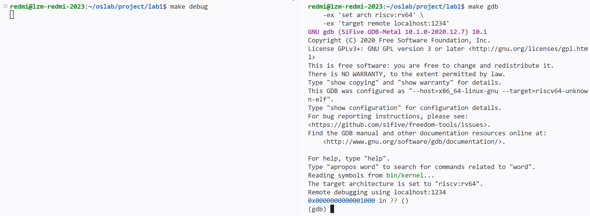


此时 PC 被硬件强制设置为固定的复位地址 0x1000

2. 输入 `x/10i $pc` 查看最初的10条指令，实际结果如下：

```asm
0x1000: auipc t0,0x0             #把 pc 当前地址 0x1000 放入 t0
0x1004: addi  a1,t0,32           #把 0x1020 地址放入 a1
0x1008: csrr  a0,mhartid         #读取当前硬件线程的编号，并存入a0
0x100c: ld    t0,24(t0)          #从 0x101a 读取数据放入 t0
0x1010: jr    t0                 #跳转到 t0 中保存的地址 0x80000000
0x1014:      unimp
0x1016:      unimp
0x1018:      unimp
0x101a:      0x8000
0x101c:      unimp
```

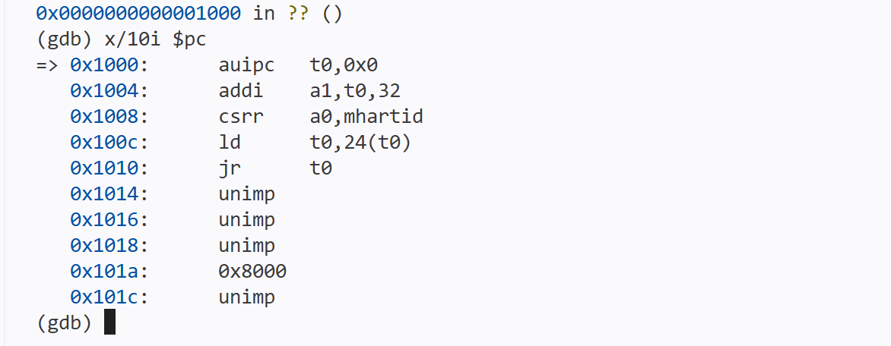

CPU初始化固件的汇编代码是：把当前地址 `0x1000` 放入 `t0`；然后把地址 `0x101a` 放入 `a1`；再读取当前硬件线程编号到 `a0`；接着从 `0x1018` 读取OpenSBI入口地址 `0x80000000` 到 `t0`，最后跳转到 OpenSBI 入口地址

3. 然后设置内核入口断点`b* kern_entry`，然后继续按`si`单步执行，同时用`info registers`查看所有寄存器的值：

```gdb
0x0000000000001000 in ?? ()
(gdb) b* kern_entry
Breakpoint 1 at 0x80200000: file kern/init/entry.S, line 7.
(gdb) si
0x0000000000001004 in ?? ()
(gdb) si
0x0000000000001008 in ?? ()
(gdb) si
0x000000000000100c in ?? ()
(gdb) si
0x0000000000001010 in ?? ()
(gdb) si
0x0000000080000000 in ?? ()
(gdb) info registers
t0             0x80000000       2147483648
a1             0x1020   4128
pc             0x80000000       0x80000000
```

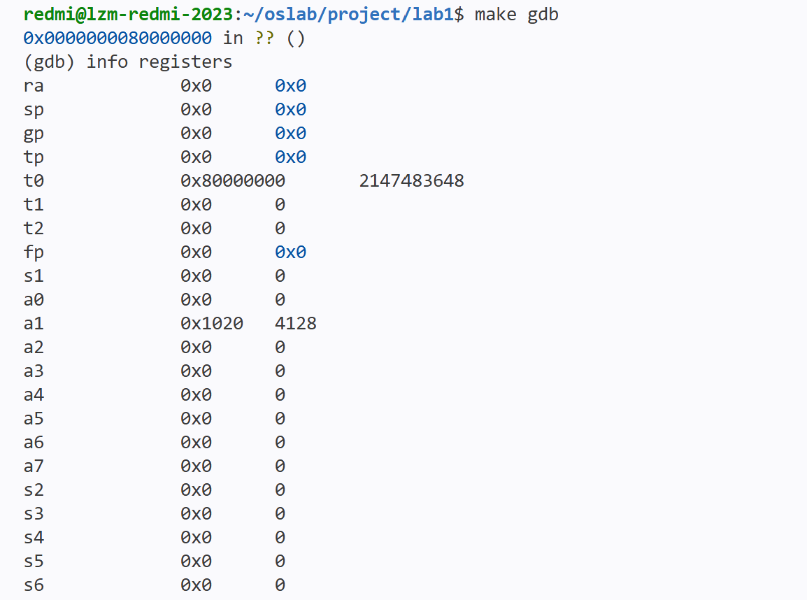

CPU 跳转到 0x80000000 处继续运行，并将控制权交给 OpenSBI


4. 接着输入`x/10i 0x80000000`查看后10条指令：

```asm
(gdb) x/10i 0x80000000
=> 0x80000000: csrr  a6,mhartid     # 读取当前硬件线程编号，存入 a6
0x80000004: bgtz  a6,0x80000108     # 若 a6 > 0，跳转到 0x80000108
0x80000008: auipc t0,0x0            # 将地址 0x80000008 放入 t0
0x8000000c: addi  t0,t0,1032        # t0 = 0x80000410
0x80000010: auipc t1,0x0            # 将当前地址 0x80000010 放入 t1
0x80000014: addi  t1,t1,-16         # t1 = 0x80000000
0x80000018: sd    t1,0(t0)          # 将 t1 写入地址 0x80000410
0x8000001c: auipc t0,0x0            # 将地址 0x8000001c 放入 t0
0x80000020: addi  t0,t0,1020        # t0 = 0x80000418
0x80000024: ld    t0,0(t0)          # 读取地址 0x80000418 读取数据，存入 t0
```

作为 bootloader 的 OpenSBI.bin 被加载到物理内存以物理地址 0x80000000 开头的区域上，进行主初始化，加载并启动操作系统内核

5. 输入`c`执行到 kern_entry 断点处停止

```asm
(gdb) c
Continuing.
Breakpoint 1, kern_entry () at kern/init/entry.S:7
7           la sp, bootstacktop
```
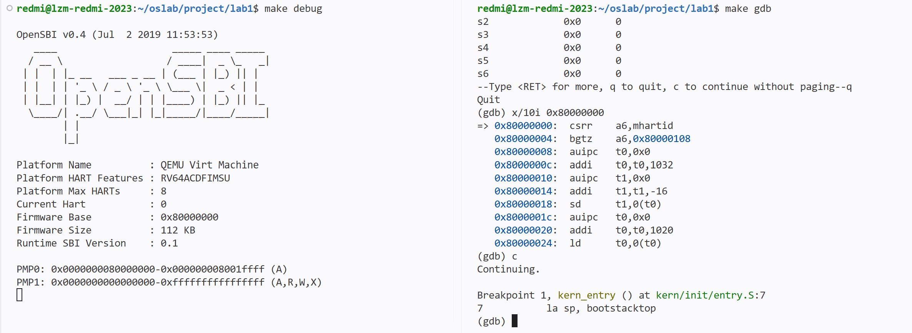

此时停在了入口函数的第一条汇编指令处，将 OpenSBI 控制权移交内核，指令`la sp, bootstacktop`会将内核启动栈的栈顶地址放入栈指针寄存器 sp，为后续 C 函数的执行准备栈空间

6. 接着输入`x/5i $pc` ，查看汇编代码:
```asm
(gdb) x/5i $pc
=> 0x80200000 <kern_entry>:     auipc   sp,0x3
   0x80200004 <kern_entry+4>:   mv      sp,sp
   0x80200008 <kern_entry+8>:   j       0x8020000a <kern_init>
   0x8020000a <kern_init>:      auipc   a0,0x3
   0x8020000e <kern_init+4>:    addi    a0,a0,-2
```

可知，kern_entry 分配好内核栈，会跳转到 kern_init()函数

7. 设置断点`b kern_init`,并执行`c`

```
(gdb) b kern_init
Breakpoint 2 at 0x8020000a: file kern/init/init.c, line 8.
(gdb) c
Continuing.
Breakpoint 2, kern_init () at kern/init/init.c:8
8           memset(edata, 0, end - edata);
```

CPU 执行kern_init 初始化内核环境，清理 .bss 段，继续执行`c`，debug 终端输出信息

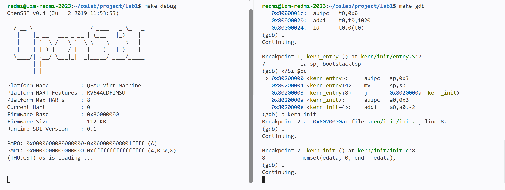


#### 练习2问题

**RISC-V 硬件加电后最初执行的几条指令位于什么地址？它们主要完成了哪些功能？**

```asm
0x1000: auipc t0,0x0             #把 pc 当前地址 0x1000 放入 t0
0x1004: addi  a1,t0,32           #把 0x1020 地址放入 a1
0x1008: csrr  a0,mhartid         #读取当前硬件线程的编号，并存入a0
0x100c: ld    t0,24(t0)          #从 0x101a 读取数据放入 t0
0x1010: jr    t0                 #跳转到 t0 中保存的地址 0x80000000
0x1014:      unimp
0x1016:      unimp
0x1018:      unimp
0x101a:      0x8000
0x101c:      unimp
```

加电后最初执行的指令位于复位地址 `0x1000`到`0x1010`。它们主要准备启动参数（硬件线程编号、设备树地址），读取固件入口地址，并跳转到 `0x80000000` 的 OpenSBI。

OpenSBI 从 `0x80000000` 开始执行。OpenSBI 完成基础初始化后，将控制权交给 `0x80200000` 处的内核。因此，本次调试验证的执行顺序为：**`0x1000 → 0x80000000（OpenSBI）→ 0x80200000（内核入口）`**。

---

## 五、测试与验证

**测试截图：**

**旧版qemu**


**新版qemu:**

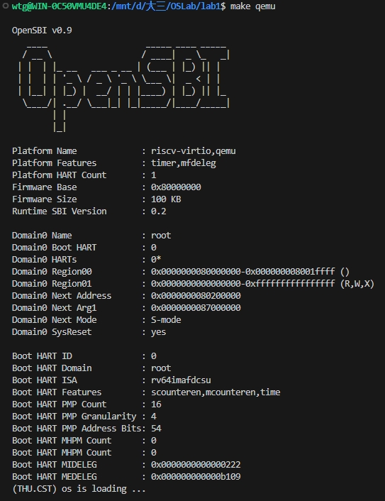

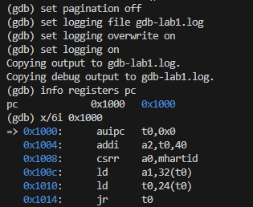

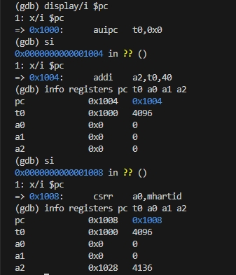

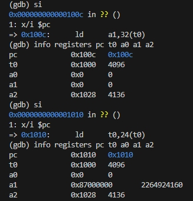

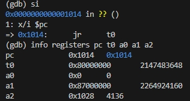

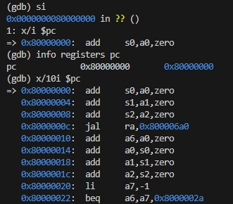

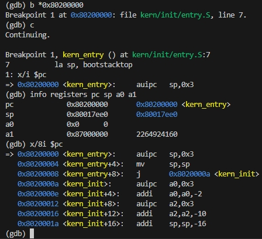

---

## 六、实验总结与收获

### 6.1 实验知识点与 OS 原理的联系

| 实验知识点                  | 对应原理                   | 本实验体现及边界                                             |
| --------------------------- | -------------------------- | ------------------------------------------------------------ |
| MROM、OpenSBI、内核逐级接管 | 系统引导与启动阶段划分     | 实际追踪三段入口；QEMU 完成镜像预加载，与真实磁盘引导器读取文件的过程不同 |
| M 模式固件与 S 模式内核     | 特权级与系统服务接口       | 启动信息展示向 S 模式移交控制权；尚未进入用户态              |
| SP 与尾跳转                 | 调用约定和函数执行上下文   | 分析入口如何准备栈并进入 C；这里的启动栈还不是后续的进程调度机制 |
| 链接脚本与入口符号          | 程序的编译、链接和装载     | 链接地址、反汇编地址和断点地址对应起来；本实验未建立分页地址空间 |
| BSS 清零                    | C 运行环境与静态存储初始化 | `kern_init` 负责清零指定区间；不等于实现了物理内存分配器     |
| `ecall` 与 SBI 输出         | 异常入口和固件服务调用     | 内核经 SBI 请求控制台输出；不同于用户程序调用操作系统的系统调用接口 |

本实验尚未实际涉及进程创建与调度、分页和缺页处理、文件系统、同步互斥，以及完整的中断处理。这些机制需要在基本启动环境建立后，结合后续实验进一步实现和验证

---

