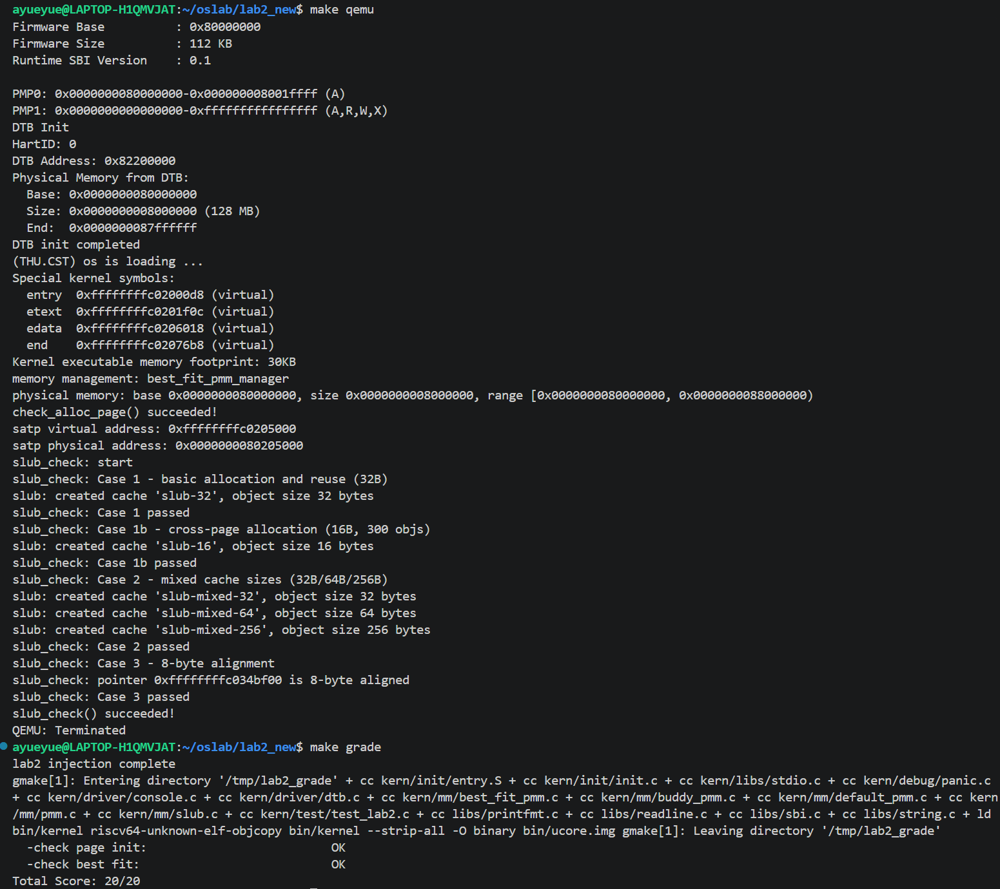
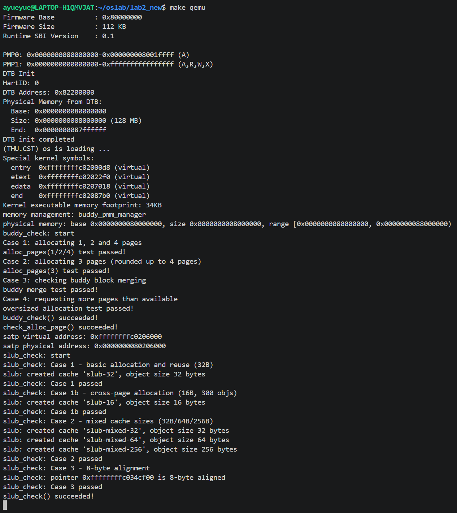

# 操作系统实验报告

## 实验基本信息

| 项目 | 内容 |
|------|------|
| **实验名称** | Lab 2：物理内存初始化与分配 |
| **小组成员** | 2413115-刘卓明、2411153-李江楠、2411248-沈东阳 |
| **完成日期** | 2026-10-25                                     |

### 小组分工

| 成员 | 实验任务 | 报告分工 |
|------|----------|----------|
| 2413115-刘卓明 | 功能模块一：物理内存探测与页描述符初始化；硬件内存范围获取思考题 | 模块一的功能分析，思考题与GDB调试 |
| 2411153-李江楠 | 功能模块二任务一：First-Fit 分析；任务二：Best-Fit 实现 | First-Fit 流程与改进分析、Best-Fit 规格与提示词、代码分析和验证说明 |
| 2411248-沈东阳 | 功能模块二任务三：Buddy System；扩展任务：SLUB | Buddy、SLUB 的实现与测试提示词、迭代记录及测试覆盖分析 |

## 一、实验目的

1. 理解内核如何利用设备树获取物理内存范围，建立页描述符并排除固件、内核和管理数据占用的页面。
2. 掌握连续物理页分配中的空闲块组织、查找、分割、释放与合并，比较 First-Fit、Best-Fit 和 Buddy System 的取舍。
3. 理解页分配与对象分配的层次关系，通过简化 SLUB 满足小对象的分配需求。
4. 学习以接口约束、前置条件、后置条件和边界场景编写提示词，并结合源码、断言和运行结果审查 AI 生成代码。

## 二、实验环境

| 成员 | AI 编程工具 | 底层模型 | 备注 |
|------|------------|----------|------|
| 2413115-刘卓明 | codexCLI | GPT-6 | 物理内存初始化 |
| 2411153-李江楠 | codex（VS Code插件） | GPT-6            | First-Fit / Best-Fit |
| 2411248-沈东阳 | codex（VS Code插件） | DeepSeek-v4flash | Buddy / SLUB |

## 三、实验整体逻辑分析

### 3.1 本章节的逻辑主线

本实验围绕物理内存在哪里、如何描述、如何分配三个问题展开。设备树提供 RAM 的起点与大小；`page_init()` 用 `struct Page` 数组描述物理页，排除已占用空间后登记空闲页；具体分配器通过统一的 `pmm_manager` 接口管理这些页面。SLUB 再利用页分配接口构造对象缓存，将分配粒度从整页缩小到对象。框架中的 `entry.S` 已经设置启动页表并写入 `satp`，随后才进入 C 语言初始化流程。`page_init()` 在已有映射下组织物理内存，并不负责重新建立 Sv39 页表；`Page` 描述符和空闲链表也不是硬件页表。

### 3.2 功能的逐步实现

1. **取得内存信息。** `dtb_init()` 解析启动时传入的设备树，供后续查询 RAM 基址和大小。
2. **初始化管理器及页描述符。** `pmm_init()` 先通过 `init_pmm_manager()` 选中管理器并清空其内部状态，再调用 `page_init()` 建立描述符数组，将完整空闲页交给 `init_memmap()`。
3. **理解 First-Fit 并实现 Best-Fit。** 两者共享页描述符和地址有序链表的基本设计，主要差别在候选空闲块的选择规则。完成实现后必须切换管理器，才能真正执行 Best-Fit 的分配与检查。
4. **扩展 Buddy System。** 按阶组织大小为 2 的幂次的块，通过拆分和伙伴合并提供页级分配。
5. **扩展 SLUB。** 在当前页分配器之上申请物理页，转换成可访问的内核虚拟地址，再切分为对象并维护缓存空闲链表。

主要调用链为：

```text
kern_init() → dtb_init() → pmm_init()
                            ├─ init_pmm_manager() → manager->init()
                            ├─ page_init() → init_memmap()
                            └─ check_alloc_page() → manager->check()
之后：alloc_pages()/free_pages() → 当前管理器
扩展：SLUB 对象接口 → alloc_pages(1) → 当前管理器
```

Best-Fit 与 Buddy 是分别选择、分别启动验证的两种页管理器，并非一次启动中同时接管同一组空闲页。SLUB 使用统一页接口，因此两张截图中分别以 Best-Fit 和 Buddy 为底层都能运行。

## 四、实验内容与实现

### 4.1 功能模块一：物理内存初始化

**负责人：** 2413115-刘卓明

#### 模块功能描述

**需要实现/修改的函数：**

```
static void page_init(void);
```

**功能说明：**

本模块负责物理内存管理的初始化，为后续页面分配和回收提供基础。page_init() 根据设备树提供的内存信息，进行物理内存探测，设置虚实地址偏移、物理页号上界和页描述符数组，建立物理页与描述符之间的对应关系。初始化时，需要限制管理上界并处理页面对齐，保留 OpenSBI、内核镜像和描述符数组占用的页面，只将剩余完整页面登记为空闲页。设备树信息无效或内存无法容纳必要数据时，终止初始化；没有完整空闲页时，保持空闲区为空，不进行注册。该函数由 pmm_init() 在物理内存管理器初始化后调用，通过 init_memmap() 将空闲页面交给当前管理器。后续的 alloc_pages() 和 free_pages() 依赖这里建立的初始状态完成分配与回收。

#### 最终提示词

以下是经过迭代优化后，最终成功实现该功能的提示词：

````markdown
[PROMPT]

**任务**：
在`kern\mm\pmm.c`中标有`//lab2 function1 YOUR CODE`的位置，实现`static void page_init(void)`函数，完成物理内存探测与页描述符初始化功能。
这个函数需要处理以下场景：
物理内存探测：使用设备树提供的内存基址和大小确定物理内存范围
描述符布局：正确设置va_pa_offset、npage和pages，并区分Page描述符地址与物理地址
已用空间排除：不把OpenSBI、内核镜像和Page描述符数组占用的页面交给物理内存管理器
页面边界处理：正确处理可管理上界、页面向上或向下对齐以及物理页号转换
异常处理：设备树信息无效时终止初始化，没有可用完整页面时不调用init_memmap()

**操作要求**：必须在项目中修改实际文件，而不是仅展示代码。
使用已有的 `get_memory_base()` 和 `get_memory_size()` 读取物理内存基址与大小。

**输出要求**：直接在标记位置写入完整实现，保留文件中现有代码与测试函数
使用下列 [RELY]、[GUARANTEE] 和 [SPECIFICATION] 中的信息，以工程真实代码为准。
实现要能通过`tools/test_lab2.c`文件下 `test_page_init()`的测试函数，并正常编译运行。
编译运行时输出探测到的物理内存基址、大小和地址范围。


[RELY]

查询物理内存基址和大小接口`get_memory_base(),get_memory_size()`(`kern\driver\dtb.h`)
```c
uint64_t get_memory_base(void);
uint64_t get_memory_size(void);
```

内存相关地址宏定义、页状态宏定义与页描述符结构(`kern\mm\memlayout.h`)
```c
#define KERNBASE            0xFFFFFFFFC0200000
#define PHYSICAL_MEMORY_END         0x88000000
#define PHYSICAL_MEMORY_OFFSET      0xFFFFFFFF40000000
struct Page {
    int ref;                        // page frame's 
    uint64_t flags;                 // array of flags 
    unsigned int property;          // the num of free 
    list_entry_t page_link;         // free list link
};
#define PG_reserved                 0       
#define PG_property                 1 
#define SetPageReserved(page)       ((page)->flags |= (1UL << PG_reserved))
```

页面大小、偏移常量(`kern\mm\mmu.h`)
```c
#define PGSIZE          4096                    // bytes mapped by a page
#define PGSHIFT         12                      // log2(PGSIZE)
#define PPN(la) (((uintptr_t)(la)) >> PGSHIFT)
```

页相关函数与全局变量（`kern\mm\pmm.c`、`kern\mm\pmm.h`）
```c
struct Page *pages;
size_t npage = 0;
uint64_t va_pa_offset;
const size_t nbase = DRAM_BASE / PGSIZE;
const struct pmm_manager *pmm_manager;
static void init_memmap(struct Page *base, size_t n)
#define PADDR(kva)
static inline void set_page_ref(struct Page *page, int val) 
static inline struct Page *pa2page(uintptr_t pa) 
```

页面对齐函数(`libs/defs.h`)
```c
#define ROUNDDOWN(a, n) 
#define ROUNDUP(a, n) 
```

异常终止接口`panic(...)`(`kern/debug/assert.h`)
```c
#define panic(...)
```

[GUARANTEE]

必须实现的接口：

```c
static void page_init(void);
```
该由`pmm_init()` 调用，不接收参数，不返回结果，建立物理页描述符布局并注册初始空闲页面。

你可以根据需要添加：
本模块内部使用的 `static` 辅助函数。
模块内部使用的`static`变量

[SPECIFICATION]

## page_init 函数

**Pre-Condition**：
- 内核已初始化，地址映射有效。
- `dtb_init()` 已执行，两个查询接口可用。
- pmm_manager已初始化，且 `nr_free_pages()`为 0。

**Post-Condition**：

**Case 1：**
若内存信息有效，且有完整空闲页，`get_memory_base() == DRAM_BASE`、`get_memory_size() > 0`，地址计算无溢出，且Page描述符数组未超出范围、仍有完整空闲页时，应正确设置 `va_pa_offset`、`npage` 和 `pages`，初始化描述符并调用 `init_memmap()` 注册空闲页。

**Case 2：**
若物理内存信息无效，当 `get_memory_base() != DRAM_BASE`、`get_memory_size()<=0`、或内存末端计算溢出时，应调用 `panic()` 终止初始化。

**Case 3：**
若内核、描述符数组无法完整放入按页对齐后的管理范围时，应调用 `panic()`初始化终止。

**Case 4**
若没有完整空闲页，`nr_free_pages()` 为 0；正常返回，不调用 `init_memmap()`。
````

#### 实现迭代过程

本模块经过 1 次实现迭代完成，未记录具体失败日志，因此不另行补写不存在的错误过程

### Challenge：硬件的可用物理内存范围的获取方法

**负责人：** 2413115-刘卓明

如果 OS 无法提前知道当前硬件的可用物理内存范围，请问你有何办法让 OS 获取可用物理内存范围？

**运行时地址空间探测**：如果操作系统运行在没有任何固件提供信息的情况下，可以通过不断的写入读取数据来测试，设计相应的异常捕捉机制，当访问超出物理内存范围的地址时，会引发异常，通过这个来确定物理地址边界。

### 4.3 功能模块二任务一：理解 First-Fit 连续物理内存分配

**负责人：** 2411153-李江楠

#### 模块功能描述

**需要实现/修改的函数：**

本任务为阅读与思考题，无需修改代码，需要理解以下已有函数：

```c
static void default_init(void);
static void default_init_memmap(struct Page *base, size_t n);
static struct Page *default_alloc_pages(size_t n);
static void default_free_pages(struct Page *base, size_t n);
static size_t default_nr_free_pages(void);
```

**功能说明：**

- **在系统中的作用：** First-Fit 是框架提供的连续物理页分配器，负责组织空闲页并支持内核申请和归还连续物理内存，也为后续 Best-Fit 实现提供参考。
- **需要处理的主要场景：** 初始化空闲链表、登记可用页、查找首个满足请求的空闲块、分割较大的块、处理分配失败，以及回收页面并合并物理相邻的空闲块。
- **与其他模块的交互关系：** `page_init()` 通过 `init_memmap()` 将可用页交给分配器；内核通过 `pmm_manager` 的统一接口调用分配、释放和计数函数；已有检查函数验证分配与回收行为。

First-Fit 的规则是：沿空闲链表查找，遇到第一个长度不小于申请页数的块就分配。框架将空闲块按物理地址递增排列，因而这里的“第一个”也是地址最小的可用候选。

`free_area` 包含空闲链表 `free_list` 和空闲页总数 `nr_free`。只有空闲块首页的 `page_link` 接入链表，其 `property` 表示块的页数，`PG_property` 标明它是空闲块头；块内其他页不是独立节点。`PG_property=0` 既可能出现在已分配页，也可能出现在空闲块内部页，因此它不是完整的“已分配”标志。`le2page()` 通过减去 `page_link` 在结构体中的偏移取得 `Page *`，不执行页表查询。

#### 最终提示词

本任务为阅读和思考题，没有独立的代码生成提示词

#### 初始化、分配、释放与合并过程

1. **`default_init()`：** 初始化循环双向链表哨兵，将 `nr_free` 置零，只建立管理器状态。
2. **`default_init_memmap(base, n)`：** 断言 `n > 0` 且所有待登记页原为保留页，清除页标志和块长、将引用计数置零；令首页 `property=n` 并设置块头标志，再按地址顺序插入链表，空闲页数增加 `n`。当前参考代码只负责登记和有序插入，并未在此函数中合并多次登记的相邻区间。
3. **`default_alloc_pages(n)`：** 总空闲页数不足时立即返回 `NULL`，否则扫描链表，选中第一个 `property >= n` 的块。摘除旧块头；若原块更大，则从低地址端分配 `n` 页，把 `page+n` 设为剩余块头并放回原链表位置。最后清除已分配首页的空闲块头标志，令 `nr_free -= n`。即使总页数足够，若没有单个连续块满足要求，也返回 `NULL`。
4. **`default_free_pages(base, n)`：** 检查页数及页标志，清空归还范围的状态和引用计数，建立长度为 `n` 的块，按地址插入链表并令 `nr_free += n`。随后先判断前驱末端是否等于 `base`，若相邻就合并并把 `base` 更新为前驱；再用更新后的块头判断是否与后继相邻，完成另一侧合并。合并移除失效块头，不再改变空闲页总数。
5. **`default_nr_free_pages()`：** 返回维护的空闲页总数，单位是页而非空闲块。

例如空闲区中存在互不相邻的 6 页块和 3 页块，申请 2 页时 First-Fit 使用前面的 6 页块，留下 4 页余块。若随后释放的区间恰好连接左右两个空闲块，则需要连续做左右两次合并。

#### 思考题目：原有 First-Fit 是否有改进空间？

有，设空闲块数量为 `F`，当前分配最坏需要扫描 `O(F)` 个块，释放的有序插入也是 `O(F)`；找到位置后的邻接合并是常数次操作。长期从链表头搜索可能反复经过较多小块，分割也可能产生外部碎片。

可以使用带最大可用块长度信息的地址索引加快查找，也可以采用大小分类管理空闲块。Next-Fit 从上次位置继续搜索，可能减少重复扫描，但改变选择策略且不保证碎片更少。对初始化过程，还可补充相邻区间合并，以支持多段连续区域分批登记。若需要检测空闲块内部页的重复释放，可增加逐页分配状态或范围重叠检查；当前断言不足以覆盖所有非法释放。

### 4.4 功能模块二任务二：Best-Fit 连续物理内存分配

**负责人：** 2411153-李江楠

#### 模块功能描述

**需要实现/修改的函数：**

```c
static void best_fit_init(void);
static void best_fit_insert_block(struct Page *base);
static void best_fit_init_memmap(struct Page *base, size_t n);
static struct Page *best_fit_alloc_pages(size_t n);
static void best_fit_free_pages(struct Page *base, size_t n);
static size_t best_fit_nr_free_pages(void);
static void init_pmm_manager(void);  // pmm.c：切换当前管理器
static void best_fit_check(void);  // 框架已有测试
extern const struct pmm_manager best_fit_pmm_manager;
```

**功能说明：**

- **在系统中的作用：** Best-Fit 为内核提供连续物理页的分配与回收。在所有满足申请的空闲块中选择长度最小者，长度相同则选择地址最低者，成功时精确分配所请求的 `n` 页。
- **需要处理的主要场景：** 初始化管理器、登记空闲页、选择最佳块、恰好匹配或分割余块、资源不足时返回失败，以及释放后的有序插入和左右相邻块合并。同时维护页状态和空闲页总数，并兼容已有测试暂时隔离空闲链表的状态。
- **与其他模块的交互关系：** 接收 `page_init()` 登记的空闲页，通过 `best_fit_pmm_manager` 注册各管理函数，并在 `pmm.c` 的 `init_pmm_manager()` 中切换管理器，使统一的分配、释放和检查接口调用 Best-Fit；已有 `basic_check()` 和 `best_fit_check()` 保持不变。

本节依据根目录 `best_fit_pmm.c` 中 `//lab2 function2-2 2411153` 到框架测试之前的实现撰写。

模块采用私有 `free_area_t free_area`，以宏提供测试需要直接访问的 `free_list` 和 `nr_free`。管理器注册对象将初始化、登记、分配、释放、计数与检查回调绑定到对应函数。`pmm.c` 中的 `init_pmm_manager()` 选择 `&best_fit_pmm_manager` 后，对外页操作才会转发到本模块。

#### 最终提示词

以下是本任务最终采用并成功实现该功能的提示词：

````markdown
[PROMPT]

**任务**：请为当前 ucore Lab2 工程实现并接入 Best-Fit（最佳适应）连续物理页分配器。当前工作目录下的工程根目录为 `lab2/lab2_new/`，以下源码路径均相对于该工程根目录。

在 `kern/mm/best_fit_pmm.c` 的 `//lab2 function2-2 YOUR CODE` 标记之后，补全管理器内部状态、管理函数以及 `best_fit_pmm_manager` 注册对象。
在 `kern/mm/pmm.c` 的 `init_pmm_manager()` 中，将当前管理器从 `default_pmm_manager` 切换为 `best_fit_pmm_manager`。
本任务完成的是物理页分配：从空闲块中选择最小的合适块，精确分配所请求的连续页数，正确分割、释放和合并，使初始化、分配、回收、计数和检查形成完整模块。

**操作要求**：

1. 执行此提示词时，必须修改工程中的实际文件，而不是只在回复中展示代码。先阅读 `kern/mm/default_pmm.c`、`kern/mm/best_fit_pmm.c`、`kern/mm/best_fit_pmm.h`、`kern/mm/pmm.h`、`kern/mm/pmm.c`、`kern/mm/memlayout.h`、`libs/list.h` 和 `libs/defs.h`，核对接口与现有测试。
2. 只允许修改上述两个目标 `.c` 文件。`best_fit_pmm.c` 仅在指定标记处增加实现，保留已有头文件包含、注释及两个测试函数；`pmm.c` 仅修改 `init_pmm_manager()` 中选择管理器的赋值语句，保留其他逻辑。
3. 不得修改 `basic_check()`、`best_fit_check()`、评分脚本、现有公开头文件、`struct Page` 或 `struct pmm_manager`；不得通过跳过检查、伪造输出或改写断言使测试通过。
4. 参考 First-Fit 的状态维护方式，但分配时必须遵守 Best-Fit 选择规则，不能仅改名称后仍选择第一个合适块。不引入 Buddy、SLUB、动态页表映射或其他任务。
5. 当前任务依赖功能模块一已经正确建立物理页描述符和初始空闲区。若实际工程仍缺少 `page_init()`，完成本任务范围内的实现与接入后，应保留该依赖现状并说明验证受阻，不得擅自补写或绕过它。

**输出要求**：

使用下述 `[RELY]`、`[GUARANTEE]` 和 `[SPECIFICATION]` 实现；接口定义以实际工程为准。发现不能兼容的约束时先说明具体冲突，不得静默改动禁止修改的部分。
完成后说明修改文件、各接口职责、Best-Fit 与 First-Fit 的关键差别，以及分割和双向合并如何维持页数守恒。
用简短例子解释 `Page`、空闲块、`page_link` 与页表项的区别，说明 `le2page()` 为什么能从成员地址找回描述符。
在配套工具链与初始化依赖齐备时进行编译、运行和已有检查，可使用工程提供的 `make qemu`、`make grade`。若前置条件不足，列出实际尝试、失败原因和未完成验证项；不能把静态分析写成测试已通过。
输出实际结果摘要，不要求完整运行地址与讲义示例完全相同，不新增无关日志。保留已有的管理器名称和检查输出；不得手工打印成功字符串代替真实检查。
简述当前算法的查找复杂度，以及按大小建立索引等改进方向和相邻块合并的配套代价；本任务不要求实施这些优化。

[RELY]

以下定义只作为已有上下文引用，不要在目标文件中重复定义已有类型或公开接口。

**1. 管理器接口与调用关系**

`kern/mm/pmm.h` 已有以下接口，排版作了压缩，成员类型保持一致：

```c
struct pmm_manager {
    const char *name;
    void (*init)(void);
    void (*init_memmap)(struct Page *base, size_t n);
    struct Page *(*alloc_pages)(size_t n);
    void (*free_pages)(struct Page *base, size_t n);
    size_t (*nr_free_pages)(void);
    void (*check)(void);
};

extern const struct pmm_manager *pmm_manager;
struct Page *alloc_pages(size_t n);
void free_pages(struct Page *base, size_t n);
size_t nr_free_pages(void);

#define alloc_page() alloc_pages(1)
#define free_page(page) free_pages(page, 1)
```

`pmm.c` 中的对外分配、释放、计数接口会转发给当前管理器。`pmm_init()` 依次选择并初始化管理器、调用 `page_init()` 注册空闲页，然后通过 `pmm_manager->check()` 检查当前算法。`best_fit_pmm.h` 已声明：

```c
extern const struct pmm_manager best_fit_pmm_manager;
```

接口注释允许不同算法有不同粒度，但本次 Best-Fit 规定成功时精确取出 `n` 页，不进行幂次取整。

**2. 页描述符、空闲块与状态**

`kern/mm/memlayout.h` 已提供：

```c
struct Page {
    int ref;
    uint64_t flags;
    unsigned int property;
    list_entry_t page_link;
};

typedef struct {
    list_entry_t free_list;
    unsigned int nr_free;
} free_area_t;

#define PG_reserved 0
#define PG_property 1
```

可使用既有的 `PageReserved`、`SetPageReserved`、`ClearPageReserved`、`PageProperty`、`SetPageProperty`、`ClearPageProperty` 宏，以及 `page_ref()`、`set_page_ref()`。
一个 `Page` 只描述一个物理页，不是整个空闲块，也不是硬件页表项。`sizeof(struct Page)` 与物理页大小不是同一个量。
对空闲块头，`property` 表示块内物理页数量，`PG_property` 为 1；内部页不是独立链表节点，不能仅凭其 `PG_property=0` 判断它已分配。
只有空闲块头的 `page_link` 接入空闲链表。`PG_reserved` 表示该页不能交给普通分配器。
`ref` 是软件引用计数，不是 PTE 的访问权限；现有测试要求新分配页的引用计数为 0，不要在本任务中自动加一。

**3. 地址、指针与链表工具**

页大小由 `kern/mm/mmu.h` 的 `PGSIZE=4096`、`PGSHIFT=12` 给出。已有变量和转换关系为：

```c
extern struct Page *pages;
extern size_t npage;
extern const size_t nbase;

// pmm.h 中已有实现：
// page2ppn(p) = p - pages + nbase
// page2pa(p)  = page2ppn(p) << PGSHIFT
// pa2page(pa) = &pages[PPN(pa) - nbase]
```

`pages` 是描述符数组的虚拟地址，`npage` 是物理页号上界，描述符数量为 `npage - nbase`。同一描述符数组内，`p + n` 表示向后移动 `n` 个描述符，对应物理地址向后移动 `n * PGSIZE`，不能把描述符地址当成物理地址。

`libs/list.h` 提供循环双向链表及 `list_init`、`list_add`、`list_add_before`、`list_del`、`list_empty`、`list_next`、`list_prev` 等操作；`list_add(a, b)` 是在节点 `a` 之后插入节点 `b`。链表头是哨兵，不是有效 `Page` 节点，不可对哨兵调用 `le2page()`。

已有宏：

```c
// kern/mm/memlayout.h
#define le2page(le, member) \
    to_struct((le), struct Page, member)

// libs/defs.h
#define to_struct(ptr, type, member) \
    ((type *)((char *)(ptr) - offsetof(type, member)))
```

`le2page(le, page_link)` 通过减去成员偏移，取得包含该链表节点的 `Page *`，不涉及 MMU 或页表查询。本任务不修改 PTE、`satp` 或页访问权限；空闲与已分配状态变化不等于页表权限变化。

**4. 已有测试的状态约定**

`best_fit_pmm.c` 的两个测试直接使用可赋值的 `free_list` 和 `nr_free`，并保存、清空、恢复它们。使用模块私有的 `free_area_t` 并提供同名宏，可与现有约定一致，不与 First-Fit 共享内部状态。
测试会先把链表暂时清空，再把计数暂时归零；这段测试过渡期可能出现“链表为空而计数尚非零”。此时分配必须因找不到块而返回 `NULL`，不能只相信计数，也不能在入口强制断言链表总页数必等于计数。
不要新增依赖测试无法保存、恢复的隐藏空闲索引或分配历史状态，否则恢复链表和计数后可能失配。
测试允许归还一次申请范围中的子区间，也会在各子区间重新分配后，将整段连续已分配页面统一归还。因此释放契约按当前页范围定义，不要求与某次原始申请边界完全一致。
现有框架可使用 `assert()`、`panic()` 和 `cprintf()`，不依赖宿主标准库、`malloc()` 或尚未实现的内核堆分配器。

[GUARANTEE]

**在 `kern/mm/best_fit_pmm.c` 中提供以下主要接口。**内部函数名称采用下列命名，以便说明和核对：

```c
static void best_fit_init(void);
static void best_fit_init_memmap(struct Page *base, size_t n);
static struct Page *best_fit_alloc_pages(size_t n);
static void best_fit_free_pages(struct Page *base, size_t n);
static size_t best_fit_nr_free_pages(void);

// 既有测试函数的前向声明，不重写其函数体：
static void best_fit_check(void);

const struct pmm_manager best_fit_pmm_manager = {
    /* 将 name、init、init_memmap、alloc_pages、free_pages、
       nr_free_pages、check 注册为对应名称和函数。 */
};
```

注册对象的 `.name` 必须为 `"best_fit_pmm_manager"`，`.check` 必须指向已有 `best_fit_check`。注册对象不是 `static`，与头文件已有 `extern` 声明一致。由于新增代码位于测试函数之前，应正确处理函数声明顺序。

**提供与测试兼容的模块内部状态：**

```c
static free_area_t free_area;
#define free_list (free_area.free_list)
#define nr_free (free_area.nr_free)
```

**修改 `kern/mm/pmm.c` 已有函数 `static void init_pmm_manager(void)`：**令 `pmm_manager` 指向 `&best_fit_pmm_manager`，继续使用原有的名称输出和 `pmm_manager->init()` 调用。

允许增加仅在本模块使用的 `static` 辅助函数、必要的内部宏；不增加新的跨文件接口，不额外申请动态管理内存，不重定义既有类型，不改动两个测试函数。

[SPECIFICATION]

## 共同状态约束

下列约束适用于合法调用完成后的正常稳定状态；已有测试主动制造的临时隔离状态按 `[RELY]` 中的特别约定处理，不要求在该过渡状态强行修正计数。
空闲链表按对应物理地址递增排列，节点恰好代表各空闲块的头页，前后链接一致。
各空闲块互不重叠，长度为正；物理相邻且都空闲的块应合并，不能跨保留页或已分配页合并。
空闲块头的 `PG_property` 为 1，`property` 为实际连续页数；空闲块内部页不得带有空闲块头标记。非块头的 `property` 不作为有效块长，不依赖旧值推断状态。
`nr_free` 等于所有空闲块长度之和，统计的是页数而不是块数；正常状态下不超过管理范围。
分配成功扣除 `n` 页，归还合法范围增加 `n` 页；分割和合并本身不额外增减页数。
保留页不进入空闲链表；同一物理页不得被重复分配给两个尚未释放的申请。
本任务不扩展多核锁或并发分配机制。

## best_fit_init

**Pre-Condition**：管理器已被选中，尚未向该管理器登记可用物理页；这是启动初始化，不是在仍有存活分配时重置管理器。

**Post-Condition**：形成合法的空循环双向链表，空闲页数为 0，内部状态可接受后续 `init_memmap()` 调用。

**Requirements**：只初始化本模块状态，不自行探测 RAM、不建立 `pages` 数组、不覆盖其他管理器或页表数据。

## best_fit_init_memmap

**Pre-Condition**：`n > 0`，管理器已初始化；`base` 指向描述符数组中的合法页，`[base, base+n)` 对应同一有效 RAM 区域内的连续物理页，且这些页在交付前均为保留状态、与已登记空闲区不重叠。调用者已经排除固件、内核及描述符数组等占用区。

**Post-Condition**：该范围成为可分配空间，引用计数清零，页面状态符合空闲块约定；其页数计入 `nr_free`，原有空闲范围保持可用。

**Case 1**：原链表为空时，登记这段连续页，形成正确的空闲块及双向链接。

**Case 2**：原链表非空时，将新增范围按地址纳入管理；若与原有空闲块物理相邻，合并为更大连续块，否则保留为独立块。

**Case 3**：`n == 0` 或交付范围包含非保留页等违反约定的情况，应以框架断言拒绝，不把不合法区域继续登记为空闲内存。

**Requirements**：支持合法的多次登记；块长和空闲页总数只按本次新增页数增长。无需负责修复 DTB、初始化缺失或调用者提供任意损坏指针的问题。

## best_fit_alloc_pages

**Pre-Condition**：申请页数为 `n`，正常调用要求 `n > 0`；管理器已初始化，已有空闲结构有效，或正处于既有测试约定的临时隔离状态。

**Post-Condition**：成功返回分配范围首个物理页的 `Page *`；失败返回 `NULL`。无论哪种情况，都不改变其他仍在使用的分配范围，不操作页表映射。

**Case 1：存在恰好匹配的块。**选择长度为 `n` 的候选；若多个候选长度相同，选择物理地址最小的块。移除其空闲块头身份，返回该块起点，空闲页数减少 `n`，不建立零长度剩余块。

**Case 2：没有恰好匹配，但存在更大的块。**在所有长度大于 `n` 的候选中选长度最小者，长度相同时选地址最小者。从所选块的低地址端分配精确 `n` 页，剩余范围成为一个正确的空闲块，保持地址有序与状态一致，空闲页数减少 `n`。

**Case 3：资源不足或没有合适连续块。**当 `n > nr_free`，或虽然总空闲页数足够但没有单个块满足申请，或链表为空时，返回 `NULL`，不改变链表、页面元数据和空闲计数。特别是测试暂时清空链表而尚未清零计数时，也必须安全返回 `NULL`。

**Case 4：申请 0 页。**触发断言，不把它当作成功分配或合法空操作。

**Requirements**：

必须比较候选块的大小；除找到无需继续比较的最优候选等正确情形外，不能遇到第一个足够大的块就直接返回。
返回范围内的页不带保留或空闲块头标记，引用计数为 0；这些状态符合本实验契约，不代表给页表设置了某种访问权限。
用描述符指针表示页范围，不能将其强转为数据区地址返回。保存并正确使用分割前块长，不能因覆盖元数据而算错剩余页数。
不要求清零被分配物理页的数据内容，不要求改动引用计数的全局生命周期设计。时间和空间复杂度不设额外指标，优先保证行为可验证。

## best_fit_free_pages

**Pre-Condition**：`n > 0`，`[base, base+n)` 是描述符数组内连续、未越界的有效页范围；页面已分配、可由调用者归还、不含保留页且不与已有空闲块重叠，调用者保证这些页不再被使用。合法归还可以是原申请的一部分，也可以覆盖若干次申请形成的连续已分配范围。

**Post-Condition**：这 `n` 页加入空闲集合，引用计数清零，空闲页数只增加 `n`。按地址形成正确链表，所有可与归还范围连接的相邻空闲块完成合并，失效的旧块头不再留在链表中。

**Case 1：链表为空。**归还范围成为唯一空闲块。

**Case 2：左右均不相邻。**归还范围作为独立块插入正确地址位置，支持链表头部、中间和尾部的插入。

**Case 3：仅与前驱或仅与后继相邻。**与相邻的一侧合并，保留合并后最低地址处的块头，长度为参与块长度之和。

**Case 4：与前驱和后继均相邻。**三段合成一段，最终块头位于三段最低地址，长度为三段之和；合并一次之后仍须正确识别另一侧邻居。

**Case 5：参数违反基本约定。**`n == 0`、待归还页带保留标记或带已有空闲块头标记等情况应由断言拒绝。不能为了绕过错误清掉断言，也不应误把合法的子区间归还判为非法。

**Requirements**：

物理相邻以“前块起点加前块页数等于后块起点”判定；链表位置相邻本身不构成合并依据。
归还只增加一次 `n`；移除旧头节点、合并长度不再增加计数，不能对页做重复归还。
`PG_property=0` 和 `ref=0` 都不能单独证明可释放。基础实现依赖合法调用前提及既有断言，不声称它已检测所有重复释放，尤其是空闲块内部页的重复释放。
不要求建立每次申请的历史记录；不得因此拒绝现有测试的范围释放方式。

## best_fit_nr_free_pages

**Pre-Condition**：管理器已初始化。

**Post-Condition**：返回当前维护的空闲物理页总数，单位为页，不是空闲块数量或字节数。

**Requirements**：该接口只查询，不改变链表、计数和页面状态，不通过扫描重算来覆盖测试临时保存或恢复的状态。

## best_fit_pmm_manager 注册与 init_pmm_manager 接入

**Pre-Condition**：所有回调的签名与 `struct pmm_manager` 一致；已有 `best_fit_check()` 在使用前可见；目标头文件已经提供管理器外部声明。

**Post-Condition**：注册对象的每个函数指针均绑定到正确实现，检查回调绑定现有测试；`init_pmm_manager()` 选择 Best-Fit，并调用它的初始化接口，之后对外分配、释放和检查均转发到 Best-Fit。

**Requirements**：保留原有名称输出，正常启动应出现 `memory management: best_fit_pmm_manager`；不能只改显示名称而仍调用 First-Fit。不得绕过 `pmm_manager->check()` 或改动 `page_init()` 的调用顺序。

## 验收场景与解释要求

**Pre-Condition**：上述实现和接入完成；动态检查还要求配套 RISC-V 工具链、QEMU 与功能模块一初始化可用。

**Post-Condition**：保留并通过既有 `basic_check()`、`best_fit_check()`；能正常编译、启动，并在依赖满足时完成工程提供的评分检查。若依赖不满足，只报告实际完成程度与阻塞点，不伪造结论。

**Case 1：验证最佳适应而非首次适应。**用连续 5 页中的第 1～2 页和第 4 页分别形成 2 页块与 1 页块。申请 1 页时应选择后面的 1 页块，随后申请 2 页仍能使用前面的 2 页块。这是现有测试的关键辨别场景，应解释其为何能区分两种算法。

**Case 2：验证分割、合并与计数守恒。**结合既有检查，说明恰好分配、部分分配、空链表、无足够连续块、左右合并，以及全部归还后块组织和空闲总数恢复的行为。尤其核对测试清空、恢复状态与分配子区间的用法。

**Case 3：前置依赖缺失。**如 `page_init()` 尚未实现，或工具链、QEMU 不可用，指出具体位置和实际错误；在不扩大修改范围的前提下完成接口、逻辑及差异审查，明确哪些运行结果尚未验证。

**Requirements**：不修改既有测试，不新增到内核正常启动路径的额外自测；未覆盖的边界应如实列为验证限制。解释优化时，说明按地址有序链表如何帮助回收合并，以及为加快 Best-Fit 搜索新增大小索引时为何必须同步维护两种关系。
````

#### 实现分析

**初始化与登记。** `best_fit_init()` 建立空链表并清零计数。`best_fit_init_memmap()` 先完整遍历范围检查保留状态，再清零状态、块长和引用计数；设置首页为长度 `n` 的空闲块后，计数增加 `n`，调用公共辅助函数插入和合并。先检查后修改使断言检查与状态更新的顺序更清楚。

**最佳块选择。** `best_fit_alloc_pages()` 使用以下条件更新候选：

```c
if (p->property >= n &&
    (page == NULL || p->property < page->property)) {
    page = p;
    if (p->property == n) {
        break;
    }
}
```

只有严格更小的候选才替换旧候选，结合地址有序遍历，就能保证同长度时选择低地址块。找到恰好等于 `n` 的块即可提前停止，因为不存在更小且仍满足要求的块。若遍历后 `page == NULL`，函数不修改状态，直接返回失败。

**分割与状态更新。** 分配前保存 `block_size` 和原链表前驱，再摘除旧块头。若 `block_size > n`，将 `page+n` 设为长度 `block_size-n` 的余块，并插回原位置，保持地址有序。最后清除返回块头的 `PG_property`、将其 `property` 清零并执行 `nr_free -= n`。空闲页的引用计数已在登记和释放时置零，因此分配时不额外加一，也不承诺清零页内数据。

**回收与双向合并。** `best_fit_free_pages()` 验证页数和标志，重置归还页状态，建立新块并仅增加一次 `nr_free`。`best_fit_insert_block()` 统一处理登记与回收：按地址插入后，先检查 `prev + prev->property == base`；合并时清除旧 `base` 的块头标志和块长、摘除其节点，并令 `base=prev`。随后以新的 `base` 检查右侧，从而正确处理一次释放连接左右两个空闲块的情况。合并只改变组织方式，不增加空闲页数。

例如左侧空闲 2 页、右侧空闲 3 页，中间归还 1 页：页数只增加 1，合并结果是 6 页块，而不能把参与合并的 2 页和 3 页再次加入总数。该辅助函数也使本实现能够合并多次 `init_memmap()` 登记的相邻范围。

#### 实现迭代过程

本模块经过 1 次实现迭代完成，未记录具体失败日志，因此不另行补写不存在的错误过程，关键问题及最终处理如下：

| 关键问题 | 提示词约束与代码处理 |
|----------|----------------------|
| 仅改管理器名称，实际上仍是 First-Fit | 比较所有合适候选的块长；仅在恰好匹配时提前退出 |
| 测试暂时清空链表，但计数仍非零 | 遍历后检查 `page == NULL`，安全返回失败，不强制修复测试状态 |
| 合并左侧后仍使用原块头，导致漏掉右侧 | 左合并完成后更新 `base=prev`，再找后继 |
| 分割时覆盖块长或破坏顺序 | 先保存原块长和前驱，再建立余块 |
| 释放契约过严，拒绝测试的子区间释放 | 按当前合法页范围回收，不添加原始申请边界限制 |
| 管理器实现完成却没有实际接入 | 注册所有回调，在 `init_pmm_manager()` 中切换指针 |

#### 思考：Best-Fit 是否有进一步改进空间

有，设空闲块数量为 `F`，当前分配最坏为 `O(F)`，释放为遍历归还页的 `O(n)` 加有序插入的 `O(F)`；候选查找只需常数辅助空间。Best-Fit 尽量缩小本次分配留下的余块，能够保留较大块，但也可能产生许多难以利用的小块，因此不保证在所有负载下优于 First-Fit。

可按块长建立平衡树或分级索引，快速查找最小可用块；同时仍需地址关系支持相邻合并。每次分割、合并和释放都必须同步维护大小与地址两种关系，且现有测试仅保存链表和计数，新增隐藏索引必须相应设计隔离与恢复机制，不能直接添加后宣称兼容。也可统计请求分布和碎片情况，以实际负载衡量策略收益。更完整的实现还可以加入范围验证和并发保护，但本任务未扩展这些能力。

### 4.5 功能模块二任务三：Buddy System（伙伴系统）分配算法

**负责人：** 2411248-沈东阳

#### 模块功能描述

**需要实现/修改的函数：**

```c
static void buddy_init(void);
static void buddy_init_memmap(struct Page *base, size_t n);
static struct Page *buddy_alloc_pages(size_t n);
static void buddy_free_pages(struct Page *base, size_t n);
static size_t buddy_nr_free_pages(void);
static void buddy_check(void);

const struct pmm_manager buddy_pmm_manager = { ... };
```

**功能说明：**

Buddy System 是操作系统中经典的物理内存分配算法。本模块从零实现了一个完整的 Buddy System 分配器，包括：

1. **初始化**：将可用物理内存按 2 的幂次切分成尽可能大的空闲块，并挂载到对应的 `free_area[order]` 链表中。
2. **分配**：根据请求页数计算目标阶数（向上取整到 2 的幂次），从对应链表或更大阶数链表中拆分获取空闲块。
3. **释放**：将释放的块与其"伙伴"块（通过物理页号异或计算）合并，递归向上合并，直到无法合并为止。
4. **自检**：实现 `buddy_check()`，测试各种分配和释放场景，确保算法正确性。

---

#### 最终提示词 1：Buddy System 实现

> **设计思路与说明：** Buddy System 的核心难点在于“异或运算找伙伴”和“级联合并”。因此，在 Prompt 的 `[SPECIFICATION]` 中，我强制要求 AI 必须使用 `page2ppn` 和 `pa2page` 来计算物理页号，绝不能用指针直接相减。同时，我要求空闲链表必须按物理地址递增有序插入，使同阶块的遍历顺序确定；有序链表本身不保证常数时间查找。

````markdown
[PROMPT]
**任务**：在 `kern/mm/buddy_pmm.c` 和 `kern/mm/buddy_pmm.h` 中从零实现 Buddy System (伙伴系统) 连续物理内存分配模块，并注册 `buddy_pmm_manager`。修改 `kern/mm/pmm.c` 中的 `init_pmm_manager` 函数，使其替换当前内核使用的 First-Fit 物理内存管理器。buddy算法原理大致是将物理内存按 2 的 n 次幂划分成存储块，分配时若块过大则对半拆分，释放时若伙伴块空闲则递归合并。

**操作要求**：你必须在项目中修改实际文件，而不是仅展示代码。你需要从零创建 `kern/mm/buddy_pmm.c` 和 `kern/mm/buddy_pmm.h` 两个文件。**不得修改** `kern/mm/memlayout.h`、`kern/mm/pmm.h`、`libs/list.h` 等头文件已有的接口与结构体（如 `struct Page`, `free_area_t` 等）。你需要自行设计 Buddy System 分配器的内部状态（如静态的 `free_area_t` 数组）和相关管理函数（如找伙伴、计算 order 等，建议设为 static），不得新增跨文件的新接口。

**输出要求**：直接在新建的文件中写入完整实现，并在 `pmm.c` 中接入。使用下面 `[RELY]`、`[GUARANTEE]`、`[SPECIFICATION]` 的信息，若工程真实签名与样本不一致，以当前工程为准。实现必须符合 `buddy_check()` 所依赖的状态约定，能通过测试并正常编译运行。实现后还需在 `kern/mm/pmm.c` 的 `init_pmm_manager()` 中，把 `pmm_manager` 指向 `&buddy_pmm_manager`，确保内核运行与检查的是 Buddy System 实现。

[RELY]
`struct pmm_manager`（`kern/mm/pmm.h`），其中 name 为名称，其余成员为回调函数指针，Buddy 需按此注册：
```c
struct pmm_manager {
    const char *name;
    void (*init)(void);
    void (*init_memmap)(struct Page *base, size_t n);
    struct Page *(*alloc_pages)(size_t n);
    void (*free_pages)(struct Page *base, size_t n);
    size_t (*nr_free_pages)(void);
    void (*check)(void);
};
```

已由 `kern/mm/memlayout.h` 提供与 First-Fit 相同的页结构：
```c
struct Page {
    int ref;
    uint64_t flags;
    unsigned int property;
    list_entry_t page_link;
};

typedef struct {
    list_entry_t free_list;
    unsigned int nr_free;
} free_area_t;
```

链表接口（`libs/list.h`）：`list_init`、`list_add`、`list_add_before`、`list_del`、`list_empty`、`list_next`、`list_prev`，以及 `le2page`。

地址转换相关内联函数（`kern/mm/pmm.h`）：
```c
static inline ppn_t page2ppn(struct Page *page);
static inline struct Page *pa2page(uintptr_t pa);
```

[GUARANTEE]
必须实现以下接口并注册：
```c
static void buddy_init(void);
static void buddy_init_memmap(struct Page *base, size_t n);
static struct Page *buddy_alloc_pages(size_t n);
static void buddy_free_pages(struct Page *base, size_t n);
static size_t buddy_nr_free_pages(void);
static void buddy_check(void);

const struct pmm_manager buddy_pmm_manager = { ... };
```

为满足测试函数对 `free_area` 数组的引用，必须在模块内部定义：
```c
#define MAX_ORDER 11
static free_area_t free_area[MAX_ORDER];
```

[SPECIFICATION]

**`buddy_init`**
- Pre-Condition: 无
- Post-Condition: 初始化长度为 11 的 `free_area` 数组，将所有 `order` 对应的 `free_list` 置空，`nr_free` 清零。

**`buddy_init_memmap`**
- Pre-Condition: `base` 指向一段连续的物理页，`n` 为该段页数。
- Post-Condition: 这段连续内存被按 2 的幂次切分成多个块，并分别挂载到对应 `order` 的 `free_list` 上，`property` 记录了各自的阶数，总空闲页数被正确更新。
- Case 1: 遍历 `[base, base+n)`，清空 `PG_reserved` 标志，重置 `ref` 为 0。从 `n` 中循环提取最大的 2 的幂次块：每次找到最大的 `order` 使 `(1 << order) <= n`。设置首页 `PG_property`，`property = order`，插入 `free_area[order]`，`nr_free += (1 << order)`，`n` 减去该值。直到 `n` 为 0。
- Requirements: 必须保证提取出的块大小严格为 2 的幂次。

**`buddy_alloc_pages`**
- Pre-Condition: `n > 0`。
- Post-Condition: 返回分配得到的起始 `Page` 指针，其包含至少 `n` 个连续页；若空间不足则返回 `NULL`。
- Case 1: 计算目标阶数：向上取整找到最小的 `target_order` 使得 `(1 << target_order) >= n`。从 `target_order` 开始向上遍历，找到第一个非空的 `free_area[i]` 链表。将对应的块摘下，不断一分为二（拆分）：`i--`，将后半部分插入 `free_area[i]` 链表，前半部分继续拆分，直到 `i == target_order`。将最终得到的块摘除，清除 `PG_property`，更新 `nr_free -= (1 << target_order)`，返回该 Page 指针。
- Case 2: 若向上查找未找到任何可用块，直接返回 `NULL`。
- Requirements: 分配的物理页大小必须满足请求的最小 2 的幂次大小。

**`buddy_free_pages`**
- Pre-Condition: `base` 为要释放的连续内存块首页，`n` 为页数。
- Post-Condition: 释放后的内存块能够和它的“伙伴”块递归合并，最终挂载到正确的 `free_list` 中，`nr_free` 被增加。
- Case 1: 遍历释放的页，重置 `ref` 和 `flags`。计算对应的 `order`（对称向上取整），设置 `base->property = order`，`SetPageProperty(base)`。当 `order < MAX_ORDER - 1` 时循环：通过 `page2ppn(base)` 获取页号 `pfn`，通过 `buddy_pfn = pfn ^ (1 << order)` 计算伙伴页号，利用 `pa2page(buddy_pfn << 12)` 获取伙伴的 `Page`。遍历 `free_area[order]` 链表，若找到伙伴块，将其从链表摘除；若伙伴地址小于 `base`，则更新 `base = buddy_page`；`order++`，继续循环。合并结束后，将最终的 `base` 插入对应的 `free_area[order]`，更新 `nr_free`。
- Requirements: 寻找伙伴必须通过 `page2ppn` 和 `pa2page` 的异或运算来完成。

**`buddy_check`**
- Pre-Condition: 无
- Post-Condition: 通过输出 `"buddy_check() succeeded!"` 表明基本测试通过。
- Case 1: 申请 3 页内存，验证 `nr_free` 减少 4，释放后恢复。申请两个 1 页块 A、B，先释放 A 再释放 B，验证它们能够成功合并为 2 页块。
- Case 2: 申请超过当前空闲页数的内存，验证返回 `NULL`。
- Requirements: 必须使用 `assert` 对关键状态进行检查。
````

---

#### 最终提示词 2：Buddy System 测试完善

> **设计思路与说明：** 第一份 Prompt 的测试较为基础。因此，第二份 Prompt 进一步明确幂次分配、非 2 的幂次向上取整、两个单页依次释放触发伙伴合并，以及超量申请失败的检查，并要求用 `assert` 验证空闲页数量。多阶级联合并仍需更有针对性的用例。

````markdown
[PROMPT]
**任务**：修改 `kern/mm/buddy_pmm.c` 中的 `buddy_check` 函数，将内部测试逻辑替换为更详尽的测试用例，以检验 Buddy System 分配和释放的正确性。
**操作要求**：你必须在项目中修改实际文件。请替换原先简单的测试逻辑，不得修改 `basic_check` 或其他已有的测试框架函数。
**输出要求**：直接进行文件操作，写出完整的 `buddy_check` 实现。

[RELY]
```c
struct Page *alloc_pages(size_t n);
void free_pages(struct Page *base, size_t n);
size_t nr_free_pages(void);
#include <assert.h>
#include <stdio.h>
```

[GUARANTEE]
```c
static void buddy_check(void);
```

[SPECIFICATION]

**`buddy_check`**
- Pre-Condition: 无。
- Post-Condition: 所有测试用例执行完毕且无误后，打印 `"buddy_check() succeeded!"`。
- Case 1 (不同大小分配与释放): 记录初始空闲页数 `nr_free_store`。分别申请 1 页、2 页、4 页，验证返回非 NULL，且页引用计数正常。随后逐一释放，验证 `nr_free_pages()` 恢复为 `nr_free_store`。
- Case 2 (非 2 的幂次分配): 申请 3 页内存，验证底层是否实际分配了 4 页（即空闲页数减少了 4 页）。验证返回的指针可用。释放后验证空闲页数恢复。
- Case 3 (伙伴合并验证): 连续申请两个 1 页的块 A 和 B（它们必须是相邻的伙伴）。先释放 A，检查 `nr_free_pages()` 增加 1。再释放 B，验证它们是否能够成功合并。合并后，通过检查 `free_area` 数组或 `nr_free_pages()` 确认它们作为 2 页的块存在。
- Case 4 (异常与边界): 申请超过当前总空闲页数的内存（如 `nr_free_pages() + 1`），验证返回 `NULL`，且系统不崩溃。
- Requirements: 每一步分配或释放后，都要用 `assert` 验证空闲页数量的变化是否符合预期。必须有清晰的 `cprintf` 输出说明当前正在测试什么。
````

#### 实现迭代过程

**第一次迭代：**
- **遇到的问题**：AI 生成的第一版 `add_free_block()` 采用尾插法，没有维护空闲链表的物理地址递增顺序。这使空闲块遍历顺序不满足预期；链表无序本身并不必然导致伙伴合并错误。同时，初始化切块时未检查起始地址的 2 的幂次对齐，导致奇数页号起始的块无法通过异或找到伙伴。
- **解决策略**：在第二版提示词中补充 `Requirements`，明确要求“按物理地址递增有序插入”；补充 `largest_aligned_order()` 的要求，确保起始地址按 2 的幂次对齐。

**第二次迭代：**
- **最终结果**：已有运行记录显示编译启动成功，相关自检通过（`buddy_check() succeeded!`）；结论限于已有测试覆盖的场景。
- **关键改进点总结**：修正了链表有序插入、补充了 `page2ppn` 用法、增加了起始地址对齐检查，并在 `buddy_check()` 中加入了物理地址严格递增的断言。

#### 测试覆盖说明（Buddy System）

1. **核心行为覆盖（幂次分配）**：测试分别申请 1 页、2 页、4 页的标准 2 的幂次大小，验证了正常的分配路径。释放后严格使用 `assert(nr_free_pages() == nr_free_store)` 检查空闲页数是否完美恢复，这能有效检验回收逻辑是否存在“内存泄漏”。
2. **边界情况覆盖（非 2 的幂次向上取整）**：测试特别设计了 `alloc_pages(3)` 的用例。Buddy System 的硬性要求是分配大小必须为 2 的幂次，内部应该分配 4 页。通过验证 `nr_free` 是否准确减少了 4，能够直接检验代码中 `order` 向上取整和拆分逻辑是否正确。
3. **核心难点覆盖（伙伴合并）**：Buddy 算法最易出错的地方在于释放时如何寻找“伙伴”并进行级联合并。测试用例通过连续申请两个 1 页的块 A 和 B，并先释放 A 再释放 B。当 A 释放时，不能与 B 合并；当 B 释放时，算法应通过异或运算找到 A 并将其合并为一个 2 页的大块。这直接检验了 `pfn ^ (1 << order)` 寻找伙伴的核心逻辑。
4. **异常与健壮性覆盖（OOM 保护）**：测试了申请超过当前总空闲页数的内存，验证算法在面临资源耗尽时能够安全地返回 `NULL`，而不会触发 Kernel Panic 导致系统崩溃。

---

#### 规格补充与验证边界

以上提示词和两轮问题记录来源于该成员的原稿。结合迭代说明，最终理解需补充以下条件，避免仅按第一轮文字实现时重现问题：

- `MAX_ORDER=11` 对应阶数 0～10，单个块最大为 1024 页。初始化选择阶数必须同时满足剩余页数、最大阶数和起始物理页号对齐，不能只取剩余长度的最大幂次。
- 使用 `buddy_pfn = pfn ^ (1 << order)` 时，必须在转换或访问伙伴描述符前检查页号处于管理范围内；伙伴还必须是同阶空闲块，不能跨保留区合并。
- 分配 3 页实际占用 4 页，释放时应按同一取整契约回收整块。每阶 `free_area[order].nr_free` 的计数口径应保持一致，总空闲页数应与各阶空闲块所含页数之和一致，不能因拆分和合并重复计数。
- 两次单页申请不必然取得同一对伙伴。合并测试应先确认 `page2ppn(A) ^ 1 == page2ppn(B)`，并检查合并后的块结构或可重新分配的大块；仅观察页数恢复不能证明合并发生。

已有截图可确认四个 Buddy 测试阶段通过，但当前材料未附最终 Buddy 源码，无法独立核实断言的全部细节。两个单页合并主要验证一层合并，不能据此断言多阶级联、最大阶限制和所有边界均已覆盖。

### Challenge：任意大小的内存单元 slub 分配算法

**负责人：** 2411248-沈东阳

#### 模块功能描述

**需要实现/修改的函数：**

```c
struct kmem_cache *kmem_cache_create(const char *name, size_t size);
void *kmem_cache_alloc(struct kmem_cache *cachep);
void kmem_cache_free(struct kmem_cache *cachep, void *objp);
void slub_check(void);
```

**功能说明：**

SLUB 是一个基于页分配器（Buddy System）的两层架构内存分配器。其核心思想是：底层调用 `alloc_pages(1)` 从 Buddy System 获取整页物理内存，上层将整页切分成固定大小的小对象（如 32B、64B、128B），用空闲链表管理。分配时从空闲链表摘取一个对象，释放时将对象归还到空闲链表（不归还物理页）。

**实现程度说明：**

本 SLUB 实现是一个**可运行的简化版**，具备固定大小对象的分配与释放、跨页扩展、多缓存隔离、8 字节对齐切分以及虚拟地址转换等能力。它提供 `kmem_cache_create()` 创建缓存，但原稿没有给出控制块存储管理的完整细节；已说明的局限包括不支持 Slab 页级回收、缺少缓存销毁机制及并发保护。作为教学简化版，它体现了页与对象两层分配的核心思想。

---

#### 最终提示词 3：SLUB 基础实现

> **设计思路与说明：** SLUB 最大的坑在于虚拟地址转换。`alloc_pages` 返回的是 `Page` 指针，不能直接切分。因此，在 Prompt 的 `[RELY]` 中必须强制写明 `page2pa(page) + va_pa_offset`，否则可能覆盖页描述符并破坏管理状态，也可能引发访问异常。

````markdown
[PROMPT]
**任务**：在 `kern/mm/slub.c` 和 `kern/mm/slub.h` 中从零实现一个简化版的 SLUB 内存对象分配模块，并在 `kern/init/init.c` 的 `kern_init()` 函数中调用 `slub_check()` 进行测试。SLUB 采用两层架构：底层调用物理页分配器获取整页，上层将页切分为固定大小的小对象，并用空闲链表管理。

**操作要求**：你必须在项目中修改实际文件，而不是仅展示代码。你需要从零创建这两个文件。**不得修改** `kern/mm/pmm.h` 等头文件已有的接口。你需要自行设计 SLUB 的核心数据结构（如 `kmem_cache`）和内部静态函数。最后，在 `kern/init/init.c` 的初始化流程中调用 `slub_check()`。

**输出要求**：直接在新建的文件中写入完整实现，并在 `init.c` 中接入。

[RELY]
```c
struct Page *alloc_pages(size_t n);
void free_pages(struct Page *base, size_t n);
static inline uintptr_t page2pa(struct Page *page);
extern uint64_t va_pa_offset;
```

**关键提示**：当你调用 `alloc_pages` 申请到新页时，页的虚拟地址计算方式为 `void *vaddr = (void *)(page2pa(page) + va_pa_offset);`。

[GUARANTEE]
```c
struct kmem_cache;
struct kmem_cache *kmem_cache_create(const char *name, size_t size);
void *kmem_cache_alloc(struct kmem_cache *cachep);
void kmem_cache_free(struct kmem_cache *cachep, void *objp);
void slub_check(void);
```

[SPECIFICATION]

**`kmem_cache_create`**
- Pre-Condition: `size > 0`，`name` 不为空。
- Post-Condition: 返回一个指向新创建的内存缓存池控制块的指针。
- Case 1: 分配并初始化一个 `struct kmem_cache`。记录对象大小、对齐大小。初始化该 cache 内部的空闲对象链表为空。

**`kmem_cache_alloc`**
- Pre-Condition: `cachep` 指针有效。
- Post-Condition: 返回一块大小至少为指定 `size` 的内存块指针。
- Case 1 (有空闲对象): 从 `cachep` 的空闲链表中摘取一个对象并返回。
- Case 2 (无空闲对象，需分配新 Slab): 调用 `alloc_pages(1)` 申请一页（4KB）。使用 `page2pa` 和 `va_pa_offset` 将 Page 转换为虚拟地址。将该页切分为若干 `size` 大小的对象（注意：对象大小需 8 字节对齐）。利用空闲对象的内存本身存储 `next` 指针，串成链表，然后返回第一个对象。

**`kmem_cache_free`**
- Pre-Condition: `cachep` 有效，`objp` 是该 cache 分配出去的对象。
- Post-Condition: 将对象归还给 `cachep`。
- Case 1: 将 `objp` 插入到 `cachep` 的空闲链表头部。

**`slub_check`**
- Post-Condition: 打印测试成功信息（如 "slub_check() succeeded!"）。
- Case 1 (基本分配与释放): 创建一个对象大小为 32 字节的 cache，连续分配 3 个对象，验证返回指针非空且不重叠。释放这 3 个对象，再次分配，验证底层能够复用这些内存块。
- Requirements: 必须使用 `assert` 检查指针合法性。
````

---

#### 最终提示词 4：SLUB 进阶测试

> **设计思路与说明：** 为了逼出 SLUB 的跨页扩展逻辑，测试必须超过单页容量。我设计了“申请 300 个 16 字节对象”的用例，一页只能装 256 个，必须自动申请新页。同时加入了 32B/64B/256B 的混合隔离和 8 字节对齐检查。

````markdown
[PROMPT]
**任务**：修改 `kern/mm/slub.c` 中的 `slub_check` 函数，为 SLUB 分配器提供更详尽的边界测试。
**操作要求**：你必须在项目中修改实际文件，保留原有的 `//lab2 challenge-1` 注释。不得修改第一份 Prompt 中实现的核心逻辑。
**输出要求**：直接修改 `slub_check` 的内部逻辑。

[RELY]
```c
void *kmem_cache_alloc(struct kmem_cache *cachep);
void kmem_cache_free(struct kmem_cache *cachep, void *objp);
```

[GUARANTEE]
```c
void slub_check(void);
```

[SPECIFICATION]

**`slub_check`**
- Post-Condition: 测试通过后输出 "slub_check() succeeded!"。
- Case 1 (跨页分配测试): 创建一个极小的对象缓存（如 16 字节）。一页 4KB 最多容纳 256 个对象。连续分配超过 300 个对象，强制触发分配新的物理页（多个 Slab）。验证所有 300 个指针均非空且互不相同。全部释放后，再次分配，验证是否能正常复用。
- Case 2 (混合大小测试): 同时创建 32B、64B、256B 的 cache。交替从这三个 cache 中分配和释放对象，验证不同 cache 之间的空闲链表不会互相干扰。
- Case 3 (异常与边界): 验证对齐：检查分配出来的指针地址是否按 8 字节对齐。
- Requirements: 必须使用 `assert` 验证指针的合法性和对齐。必须使用 `cprintf` 打印清晰的测试阶段信息。
````

#### 实现迭代过程

**第一次迭代：**
- **遇到的问题**：AI 初版生成的 `slub_init_slab()` 中，将 `alloc_pages()` 返回的 `Page` 指针直接当作虚拟地址使用，没有进行 `page2pa + va_pa_offset` 的转换，且切分时未做 8 字节对齐处理。
- **解决策略**：在 `[RELY]` 中明确写出虚拟地址计算公式，并在 `[SPECIFICATION]` 中强调对象需 8 字节对齐。

**第二次迭代：**
- **最终结果**：已有运行记录显示编译启动成功，相关自检通过（`slub_check() succeeded!`）；结论限于已有测试覆盖的场景。
- **关键改进点总结**：补充了物理地址到虚拟地址的转换公式，增加了 `ROUNDUP(size, 8)` 的对齐要求，并在 `slub_check()` 中加入了 8 字节对齐的断言。

#### 测试覆盖说明（SLUB）

1. **核心行为覆盖（跨页 Slab 扩展）**：测试特别设计了一个 16 字节的小对象缓存，并连续申请了 300 个对象。由于一页 4KB 只能切分出 256 个 16 字节的对象，这直接强制 SLUB 触发“调用 `alloc_pages` 申请新物理页”的底层扩展逻辑。通过验证 300 个指针均非空且互不相同，有效证明了跨 Slab 链表维护的正确性。
2. **内存泄漏检查（复用验证）**：在大量分配后执行全量释放，再次申请时验证能否复用。复用检查能发现部分对象丢失问题，但不能证明所有内存泄漏均不存在；该简化实现没有向底层归还空 Slab 页。
3. **混合尺寸隔离（独立缓存验证）**：测试同时创建了 32B、64B、256B 三种不同大小的 cache，并交替进行分配和释放。这能有效检验不同的 `kmem_cache` 内部的空闲链表是否互相独立，防止由于对象大小不同导致的链表指针错乱。
4. **地址对齐验证（防崩溃机制）**：通过断言检查返回的指针地址是否按 8 字节对齐。这保证了对象及空闲链表指针的对齐约定；未对齐访问的具体结果取决于指令和运行环境，不能一概断言必然导致 Kernel Panic。

---

#### 简化 SLUB 的适用范围与规格补充

本实现体现“页级分配器 + 对象缓存”的两层思想。每个 cache 管理一种对象尺寸，多种尺寸由多个 cache 提供，并不等同于已经实现支持任意大请求的通用 `kmalloc()`。单页切分还要求对象槽能容纳链表指针，步长至少为 `ROUNDUP(max(size, sizeof(void *)), 8)`；对于零长度、超过单页容量、缓存控制块耗尽和底层页申请失败，应明确返回失败或拒绝调用。已有提示词及截图没有完整覆盖这些输入，不能认定它们都已验证。

对象归还 cache 后可被复用，但物理页仍由 cache 持有。因此“对象复用成功”和“空闲页总数恢复”是两种不同性质。本次简化实现不提供空 Slab 页回收、缓存销毁或并发保护；跨页、尺寸隔离和对齐检查验证的是当前教学范围内的行为。

## 五、测试与验证

### 5.1 Best-Fit 集成运行与评分

以下 `make qemu` 运行记录和 `make grade` 评分结果



截图显示：

```text
memory management: best_fit_pmm_manager
check_alloc_page() succeeded!
slub_check() succeeded!
  -check page init:    OK
  -check best fit:     OK
Total Score: 20/20
```

管理器名称说明运行版本确实选择了 Best-Fit；`check_alloc_page()` 在当前管理器的 `check()` 返回后打印成功，因此结合注册结构可以确认既有分配自检完成。评分输出确认该次集成运行的初始化与 Best-Fit 评分项通过。

### 5.2 Buddy System 与 SLUB 扩展运行



截图显示 `memory management: buddy_pmm_manager`，随后完成以下阶段：

| 模块 | 测试内容 | 截图结果及能够支持的结论 |
|------|----------|--------------------------|
| Buddy | 申请 1、2、4 页并回收 | `alloc_pages(1/2/4) test passed!`，基本幂次分配场景通过 |
| Buddy | 申请 3 页，向上取整至 4 页 | `alloc_pages(3) test passed!`，取整测试通过 |
| Buddy | 伙伴合并 | `buddy merge test passed!`，该合并用例通过 |
| Buddy | 超过可用页数的申请 | `oversized allocation test passed!`，该资源不足用例通过 |
| SLUB | 32B 对象基本分配与复用 | `Case 1 passed` |
| SLUB | 300 个 16B 对象跨页分配 | `Case 1b passed` |
| SLUB | 32B、64B、256B cache 混合操作 | `Case 2 passed` |
| SLUB | 8 字节对齐 | `Case 3 passed` |

最后分别输出 `buddy_check() succeeded!`、`check_alloc_page() succeeded!` 与 `slub_check() succeeded!`

## 六、实验总结与收获

### 6.1 实验知识点与操作系统原理的联系

| 实验知识点 | 对应的 OS 原理 | 联系与差异 |
|------------|----------------|------------|
| 设备树与 `page_init()` | 资源发现及物理内存布局 | 原理通常假定可用 RAM 已知；实验需要读取平台信息，并扣除固件、内核和管理结构自身占用 |
| `Page`、`property` 与空闲链表 | 页帧管理与空闲区管理 | `Page` 是软件元数据，块头描述连续页范围；硬件 PTE 则描述映射与权限，二者职责不同 |
| First-Fit 与 Best-Fit | 连续分配及外部碎片 | 前者选择首个合适块，后者选择最小合适块；总空闲量足够不代表存在足够长的连续区间 |
| 分割、释放与邻接合并 | 动态存储分配及空间回收 | 分割和合并改变块结构但不改变空闲总量；是否合并必须检查物理连续性 |
| Buddy 的阶与异或伙伴 | 分级分配及内部碎片 | 规则化块大小便于拆分、合并，但 3 页请求会占用 4 页；物理相邻不等于伙伴 |
| 简化 SLUB | 内核对象缓存与分层分配 | 从页分配器取页后复用小对象，提高小对象分配适配性；本实验未覆盖完整 SLUB 的并发和回收机制 |
| `va_pa_offset` 与地址转换 | 虚拟地址与物理地址分离 | 页分配返回描述符，访问页内容还需转换成可用虚拟地址；分配物理页本身不建立新的页表映射 |
| 断言及状态守恒 | 模块契约与系统正确性 | 接口签名一致还不够，调用前提、测试临时状态、计数单位也必须一致 |

### 6.2 AI 协作开发的经验

首先应把真实工程接口和测试约定写入提示词。Best-Fit 的临时空链表状态、合法子区间释放、`Page` 与页内数据地址的差别，都说明泛泛要求实现分配器不足以得到适配工程的结果。

其次，应将规格写成可检查的行为：分配如何选块、释放何时合并、计数增减多少、失败时是否保持状态，分别给出前置条件和后置条件。初始化与回收共享插入合并函数，也有助于减少两套逻辑发生偏差。

再次，算法提示词与测试提示词应相互检验。Best-Fit 用“低地址大块、高地址恰好块”区分选择策略；Buddy 用 3 页请求检验取整；SLUB 用超过单页容量的对象数量触发扩展。仅观察启动成功或空闲页数恢复，不足以证明选择规则、伙伴结构或对象复用全部正确。

最后，应把实际 Bug、规格预防措施和测试尚未覆盖的风险分开记录。Buddy 原稿中的块对齐问题、SLUB 原稿中的描述符误用问题都有明确修正思路；Best-Fit 没有保留早期失败日志，就依据最终代码说明处理方式。报告中的成功结论必须能对应源码或运行证据，不能用 AI 的说明代替验证。
