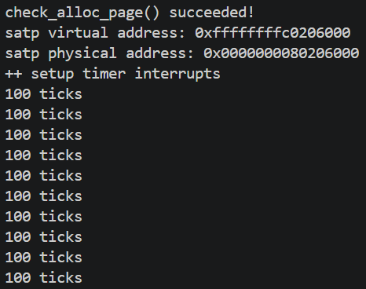
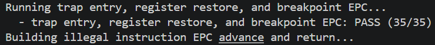
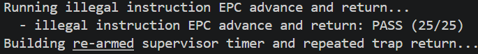
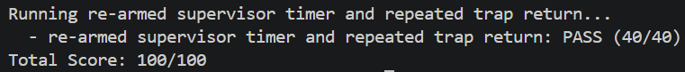

# 操作系统实验报告

## 实验基本信息

| 项目 | 内容 |
|------|------|
| **实验名称** | Lab 3：中断与异常处理 |
| **小组成员** | 2413115-刘卓明、2411153-李江楠、2411248-沈东阳 |
| **完成日期** | 2026-11-08 |

### 小组分工

| 成员 | 实验任务 | 报告分工 |
|------|----------|----------|
| 2413115-刘卓明 | 功能模块一：Trap 上下文恢复与 Trap 入口 | Trap 汇编上下文切换分析、汇编代码调试 |
| 2411153-李江楠 | 功能模块二：中断与异常处理功能 | Trap 处理函数实现、时钟中断与异常分析 |
| 2411248-沈东阳 | 实验验证与代码审查 | 测试用例分析、结果验证与总结 |

---

## 一、实验目的

1. **理解 RISC-V 中断机制**：掌握 RISC-V 架构下 Trap 的触发机制、特权级切换流程、以及关键控制状态寄存器的作用。
2. **掌握上下文切换**：深入理解 Trap 处理过程中上下文的保存与恢复逻辑，确保内核能够安全返回被打断的执行流。体会汇编与 C 语言协作的精妙。
3. **掌握中断与异常处理**：学习如何识别时钟中断、非法指令异常、断点异常，并实现正确的响应逻辑。
4. **学习 AI 辅助开发**：掌握基于四段式框架的提示词工程，学习如何通过严格的约束条件让 AI 生成正确的底层汇编和 C 语言代码，并通过测试用例驱动 AI 修复 Bug。

---

## 二、实验环境

| 成员 | AI 编程工具 | 底层模型 | 备注 |
|------|------------|---------|------|
| 2413115-刘卓明 | codexCLI | GPT-6 | 负责 Trap 汇编层 |
| 2411153-李江楠 | codex（VS Code插件） | GPT-6 | 负责 Trap C 语言处理层 |
| 2411248-沈东阳 | codex（VS Code插件） | DeepSeek-v4flash | 实验验证与测试 |

---

## 三、实验整体逻辑分析

### 3.1 本章节的逻辑主线

本实验围绕“**Trap 上下文保存与恢复 -> Trap 入口与返回 -> 中断与异常处理**”三条主线展开。操作系统作为计算机系统的监管者，必须能对突发情况做出反应。当系统遇到突发情况时，硬件会强制挂起当前执行流，跳转到内核预设的处理入口。

本章的核心目标是让内核具备完整的 Trap 处理闭环：
1. **保存现场**：将 CPU 当前的所有寄存器状态保存到内存中，形成 `Trap frame` 结构体。
2. **分发处理**：根据 `scause` 寄存器中记录的 Trap 类型，调用不同的 C 语言处理函数。
3. **恢复现场**：处理结束后，从 `Trap frame` 中恢复所有寄存器，执行 `sret` 指令返回原执行流。

这一机制不仅是实现系统调用和进程调度的基石，更是操作系统从“被动运行”走向“主动管理”的关键转折点。

### 3.2 功能的逐步实现

实验的代码实现遵循了严格的自底向上顺序：

1. **初始化中断环境**：在 `kern_init()` 中调用 `idt_init()`，将 `stvec` 寄存器设置为汇编入口 `__alltraps` 的地址，并配置 `sstatus` 寄存器使能全局中断。
2. **建立汇编入口与上下文保存**：在 `trapentry.S` 中，`__alltraps` 处的 `SAVE_ALL` 宏将 32 个通用寄存器和 4 个关键 CSR压入栈中，形成与 `struct trapframe` 严格对应的内存布局。
3. **调用 C 语言处理函数**：`__alltraps` 按照 RISC-V 调用约定，将 Trap frame 的首地址传给 `trap(struct trapframe *tf)`。
4. **Trap 分发与处理**：`trap()` 调用 `trap_dispatch()`，根据 `scause` 的最高位判断 Trap 类型，进而调用 `interrupt_handler()`或 `exception_handler()`。
5. **上下文恢复与返回**：汇编代码 `RESTORE_ALL` 严格按照 `SAVE_ALL` 的逆序从 Trap frame 中恢复寄存器，最后执行 `sret` 指令，硬件自动恢复 `sstatus` 状态并跳转到 `sepc` 处继续执行。

---

## 四、实验内容与实现

### 4.1 功能模块一：Trap 上下文恢复与 Trap 入口功能

**负责人：** 2413115-刘卓明

#### 模块功能描述

**需要实现/修改的函数或汇编：**

```asm
.macro RESTORE_ALL
__alltraps:
```

**功能说明：**

本模块负责完成 Trap 从“进入内核”到“返回原执行流”之间的底层上下文管理。这个模块是整个 Trap 机制的“骨架”，如果这层汇编写错，C 语言的任何处理逻辑都无从谈起。

1. **`__alltraps`**：建立汇编 Trap 入口与 C 语言 `trap()` 函数之间的桥梁。它需要在 `SAVE_ALL` 执行完毕后，将当前的栈指针 `sp` 按照 RISC-V 调用约定放入 `a0` 寄存器，然后执行 `jal trap` 进入 C 语言世界。
2. **`RESTORE_ALL`**：在 `trap()` 返回后，需要从 Trap frame 中恢复现场。这要求严格按照 `SAVE_ALL` 的反向顺序，将栈上的数据恢复回各个通用寄存器和控制状态寄存器。最关键的是 `sp` 的恢复，必须在其他寄存器恢复完毕后再进行，或者通过中间寄存器中转。

#### Spec 是怎么写的

在 `[SPECIFICATION]` 中，我们针对汇编代码的特殊性，做出了严格的定义：
- **Pre-Condition**：明确 `sp` 必须指向由 `SAVE_ALL` 建立的有效 Trap frame，且经过 `trap()` 处理。
- **Post-Condition**：要求恢复所有需保留的通用寄存器和 CSR ，`sp` 必须恢复到帧中保存的原用户程序的栈指针。
- **Requirements**：核心约束是“`RESTORE_ALL` 必须与 `SAVE_ALL` 保持一致，不能自行假设数据布局”。由于 `SAVE_ALL` 中对 `x2(sp)` 做了特殊处理，我们特别强调不能简单地把所有寄存器按照完全相同的方式恢复。

#### 最终提示词

以下是经过迭代优化后，最终成功实现该功能的提示词：

````markdown
# 功能模块一：Trap 上下文恢复与 Trap 入口功能
**负责人：** 2413115-刘卓明

[PROMPT]
**任务**：在 `kern/trap/trapentry.S` 的两处 `#lab3 function1 YOUR CODE` 标记下实现 Trap 入口和上下文恢复功能。

- `RESTORE_ALL`：从当前 `sp` 指向的 Trap frame 中恢复用户程序的寄存器值，以及用于 Trap 返回的 `sstatus` 和 `sepc`，使被打断程序的执行状态能够从 Trap frame 中恢复出来。
- `__alltraps`：建立汇编 Trap 入口与 `trap(struct trapframe *tf)` 之间的调用关系。使保存后的 Trap frame 能够按照 RISC-V 调用约定正确传递给 trap()。

**操作要求**：必须在项目中修改实际文件，而不是仅展示代码。仅在 `RESTORE_ALL` 宏体内和 `__alltraps` 的两处 `#lab3 function1 YOUR CODE` 标记下补全模块。保留 `__alltraps`、`__trapret`已有的代码，不要删除既有逻辑。

**输出要求**：直接在标记位置写入完整实现，保留文件中现有代码与测试函数
使用下列 [RELY]、[GUARANTEE] 和 [SPECIFICATION] 中的信息，以工程真实代码为准，不要引入无关功能。模块完成后，系统应能够形成完整的“Trap 进入 -> 上下文保存 -> C 语言处理 -> 上下文恢复 -> Trap 返回”闭环


[RELY]

**Trap frame 布局与 C 层处理接口**（`kern/trap/trap.h`，`kern/trap/trap.c`）

```c
struct trapframe {
    struct pushregs gpr;
    uintptr_t status;
    uintptr_t epc;
    uintptr_t badvaddr;
    uintptr_t cause;
};

void trap(struct trapframe *tf);
```

**已有上下文保存宏 `SAVE_ALL`**（`kern/trap/trapentry.S`）

```asm
    .macro SAVE_ALL

    csrw sscratch, sp

    addi sp, sp, -36 * REGBYTES
    # 此处省略 x0、x1 和 x3–x31 的保存指令
    csrrw s0, sscratch, x0
    csrr s1, sstatus
    csrr s2, sepc
    csrr s3, sbadaddr
    csrr s4, scause

    STORE s0, 2*REGBYTES(sp)
    STORE s1, 32*REGBYTES(sp)
    STORE s2, 33*REGBYTES(sp)
    STORE s3, 34*REGBYTES(sp)
    STORE s4, 35*REGBYTES(sp)
    .endm
```

**汇编入口、恢复宏与返回路径**（`kern/trap/trapentry.S`）

```asm
    .macro RESTORE_ALL

    #lab3 function1 YOUR CODE

    .endm

    .globl __alltraps
    .align(2)
__alltraps:
    SAVE_ALL

    #lab3 function1 YOUR CODE
    # sp should be the same as before "jal trap"

    .globl __trapret
__trapret:
    RESTORE_ALL
    # return from supervisor call
    sret
```

**RISC-V 函数调用约定与特权级返回**

- 调用 `trap()` 时，首个指针参数通过 `a0` 传递，栈指针须满足调用约定的对齐要求。
- `sret` 从 `sepc` 取得返回地址，根据 `sstatus.SPP` 恢复返回特权级，并将 `sstatus.SPIE` 的值转入 `sstatus.SIE`。


[GUARANTEE]
必须补全的汇编接口：

```asm
.macro RESTORE_ALL
__alltraps:
```

- `RESTORE_ALL` 从当前 Trap frame 恢复通用寄存器和 Trap 返回状态。
- `__alltraps` 通过已有的 `SAVE_ALL` 建立 Trap frame，将帧地址传给 `trap()`，并在 C 函数正常返回后接入现有 `__trapret`。

你可以根据需要添加：
本模块内部使用的 `static` 辅助函数。
模块内部使用的`static`变量

[SPECIFICATION]
## RESTORE_ALL

**Pre-Condition**：`sp` 指向由 `SAVE_ALL` 建立且经过 `trap()` 处理的有效 Trap frame。

**Post-Condition**：按帧中的当前值恢复需保留的通用寄存器及 Trap 返回所需的 CSR，包括 `sstatus` 和 `sepc` 。`sp` 恢复为帧中保存的原用户程序的栈指针，由已有的 `sret` 完成返回。

**Requirements**：读取帧时，`RESTORE_ALL`必须与 `SAVE_ALL` 一致，不能自行假设一个与实际 Trap frame 不一致的数据布局。

## __alltraps

**Pre-Condition**：处理器已进入 Trap，入口栈和处理器状态满足现有 `SAVE_ALL` 的使用条件。

**Post-Condition**：`trap()` 收到指向本次 Trap frame 的 `struct trapframe *`。`trap()` 正常返回后，控制流进入现有 `__trapret`，此时 `sp` 指向同一个 Trap frame。

**Requirements**：进入 `__trapret` 前，`sp` 必须重新指向本次 Trap frame。

````

#### 实现迭代过程

**本模块经过 1 次实现迭代完成**
- **最终结果**：✅ 编译通过 ✅ 测试通过（Trap entry 35/35） ✅ 功能符合预期
- **关键改进点总结**：修正了寄存器恢复顺序，确保在恢复 `sp` 之前，其他寄存器和 CSR 已经从正确的栈位置加载完毕；严格保持了 `SAVE_ALL` 和 `RESTORE_ALL` 的对称性。

---

### 4.2 功能模块二：中断与异常处理功能

**负责人：** 2411153-李江楠

#### 模块功能描述

**需要实现/修改的函数：**

```c
void interrupt_handler(struct trapframe *tf);
void exception_handler(struct trapframe *tf);
```

**功能说明：**

本模块负责对 Trap 进行分类处理。当汇编层将控制权交给 C 语言的 `trap()` 后，`trap_dispatch()` 会根据 `tf->cause` 的最高位将任务分发到这两个函数。

1. **`interrupt_handler`**：处理中断。重点是时钟中断。时钟中断是操作系统的“心跳”，处理函数需要重新设置下一次时钟事件、维护全局 `ticks` 计数、达到 `TICK_NUM` 打印信息，并在达到 `SHUTDOWN_AFTER` 后调用 `sbi_shutdown()` 关机。对于其他未知中断，需要打印提示或完整 Trap frame。
2. **`exception_handler`**：处理异常。重点是非法指令异常和断点异常。处理完信息后，必须正确更新 `tf->epc`，否则 `sret` 返回后会再次执行触发异常的指令，导致死循环。对于其他未要求的异常，调用 `print_trapframe(tf)` 兜底。

#### Spec 是怎么写的

在 `[SPECIFICATION]` 中，我们通过分类讨论的方式详细定义了行为：
- **`interrupt_handler`**：在 Case 1 中，严格定义了操作顺序：调用 `clock_set_next_event()` -> `ticks++` -> 判断是否打印 -> 判断是否关机。如果不按这个顺序，时钟中断可能只触发一次。
- **`exception_handler`**：在 Case 1 和 Case 2 中，明确规定要根据具体的异常类型调整 `tf->epc`。并在 Requirements 中强调“不能假定所有异常都使用相同的 epc 偏移量”。

#### 最终提示词

以下是经过迭代优化后，最终成功实现该功能的提示词：

````markdown
[PROMPT]

**任务**　在 `lab3/lab3_new/` 工程中实现功能模块二中断与异常处理，唯一目标文件是 `kern/trap/trap.c`。在 `//lab3 function2 YOUR CODE` 标记处、已有 `trap_dispatch()` 之前补全两个处理函数，使内核能持续响应时钟中断，并能在处理非法指令和断点后从下一条指令继续执行。

**操作要求**　执行此提示词时必须修改工程中的实际文件。保留实验标记注释，提交时用本人学号替换 `YOUR CODE`。本次只补全模块二，允许在目标文件中引用 `<sbi.h>`、定义必要的模块私有常量或静态辅助函数。保留已有函数、头文件接口、模块一的汇编和评分程序。Lab2 的物理内存管理代码作为前置依赖使用。

**输出要求**　按下列三个部分实现。完成后列出修改文件，简述时钟重设、统计与关机的先后关系，以及中断和两种已处理异常各自如何决定返回地址。无需编译、运行或评分。

[RELY]

- `kern/trap/trap.h` 中的 `struct trapframe` 包含 `uintptr_t cause`、`uintptr_t epc` 及保存的寄存器。`trap_dispatch()` 根据 `(intptr_t)tf->cause < 0` 将中断与同步异常分别交给两个处理函数。RV64 的中断标志占 `cause` 的最高位，其余位给出原因号。返回路径从同一 Trap frame 恢复 `sepc`。
- `libs/riscv.h` 定义了各特权级的软件、时钟和外部中断编号，其中 `IRQ_S_TIMER` 为 5。`CAUSE_ILLEGAL_INSTRUCTION` 为 2，`CAUSE_BREAKPOINT` 为 3。
- `kern/driver/clock.h` 提供 `extern volatile size_t ticks` 和 `void clock_set_next_event(void)`。`clock_init()` 已将计数置零并安排首次事件。后续事件需要处理函数逐次安排。
- `trap.c` 已定义 `TICK_NUM` 为 100。`print_ticks()` 输出一行 `100 ticks`，并有自己的 `DEBUG_GRADE` 分支。复用该函数并保留原有调试行为。`print_trapframe(tf)` 可输出完整现场，`libs/sbi.h` 声明了 `void sbi_shutdown(void)`。
- 实验内容用 `SHUTDOWN_AFTER` 表示关机前累计输出的行数，当前材料未给出数值，源码也未定义该宏。若构建时已指定该宏，使用指定值；否则在目标文件中给出可覆盖的默认值 10，并在修改说明中标明这一实现假设。
- `tools/grade.sh` 给出了诊断文本的大小写。`tools/test_lab3.c` 中的非法指令为 4 字节的 `.word 0x0000007b`；`tools/test_lab3_context.S` 中的 `ebreak` 后面紧接寄存器检查，须按其实际机器编码长度返回。

[GUARANTEE]

在标记处提供以下两个函数定义，保持外部链接，使现有分发函数和直接调用它们的测试都能使用同一接口。

```c
void interrupt_handler(struct trapframe *tf);
void exception_handler(struct trapframe *tf);
```

[SPECIFICATION]

## interrupt_handler

**Pre-Condition**　`tf` 指向有效的 Trap frame。正常分发携带中断标志，现有测试也会直接传入不带标志的未知原因号 15。时钟中断路径以已初始化的时钟驱动为前提。

**Post-Condition**　按去除最高标志位后的原因号完成分类，同时保留 `tf->cause` 原值供诊断。所有返回分支保持 `tf->epc`、通用寄存器和状态字原值，使被打断的执行流从保存位置恢复。

- **Case 1 · 监管态时钟中断**　每次收到 `IRQ_S_TIMER`，先设置下一次时钟事件，再将全局 `ticks` 加一。当新计数为 `TICK_NUM` 的正整数倍时，调用一次 `print_ticks()`。例如第 99 次无统计行，第 100 次和第 200 次各输出一行 `100 ticks`。统计行数达到 `SHUTDOWN_AFTER` 时，先完成最后一行输出，再调用 `sbi_shutdown()`；此前应正常返回。
- **Case 2 · 其他已识别中断**　按框架中相应的 IRQ 常量区分软件、其他特权级的时钟及外部中断，输出包含特权级和类型的提示。特别地，`IRQ_S_SOFT` 输出一行 `Supervisor software interrupt`。这些分支保持定时器、`ticks` 和统计次数原值。
- **Case 3 · 未识别中断**　输出 `Unknown interrupt: cause <十进制原因号>`，随后调用一次 `print_trapframe(tf)`。直接传入 15 时首行应为 `Unknown interrupt: cause 15`，且能正常返回。

**Requirements**　复用驱动维护的唯一 `ticks`。统计与关机取决于实际收到的监管态时钟中断次数；正常路径下，最终统计行只输出一次。中断处理不推进指令地址。

## exception_handler

**Pre-Condition**　`tf` 指向有效的同步异常现场。非法指令与断点场景中，`tf->epc` 指向实验内核中可读取的故障指令，可能仅按 2 字节对齐。其他异常的兜底路径无需读取该地址。

**Post-Condition**　对已处理的两类异常，先报告触发地址，再仅更新 `tf->epc` 到紧随故障指令的地址。保持其他现场字段、时钟与统计状态原值，由统一的 Trap 返回路径恢复执行。

- **Case 1 · 非法指令**　遇到 `CAUSE_ILLEGAL_INSTRUCTION`，输出一行 `Illegal instruction at <原 epc 的十六进制地址>`。对于工程中的 `.word 0x0000007b`，返回地址应为原地址加 4。
- **Case 2 · 断点**　遇到 `CAUSE_BREAKPOINT`，输出一行 `Breakpoint at <原 epc 的十六进制地址>`。压缩编码 `c.ebreak` 后前进 2 字节，普通 32 位编码 `ebreak` 后前进 4 字节。两者都应恰好落到断点后的第一条指令。
- **Case 3 · 其他异常**　调用一次 `print_trapframe(tf)`，保留原始异常现场后返回。例如直接传入原因号 20 时，即使 `epc` 为零也应能输出现场，包含框架已有的 `cause    0x00000014` 行。

**Requirements**　对本实验涉及的 16 位和 32 位编码，依据故障地址处首个 16 位半字的低两位判定长度：低两位非二进制 `11` 表示 2 字节，本实验的 32 位编码低两位为 `11`。仅在上述两个已处理分支读取指令。输出地址时保留 RV64 地址宽度；通过 Trap frame 传回更新后的执行位置。
````

#### 实现迭代过程

**本模块经过 1 次实现迭代完成**
- **最终结果**：✅ 编译通过 ✅ 测试通过（非法指令 25/25，时钟中断 40/40） ✅ 功能符合预期
- **关键改进点总结**：补充了时钟事件重置逻辑，修正了异常处理中的 `epc` 偏移量，确保不会陷入异常死循环。

---

## 五、测试与验证

### 5.1 时钟中断持续触发验证



**截图说明**：系统成功初始化时钟中断，并且通过 `clock_set_next_event()` 持续产生时钟中断。终端每隔一段时间打印一行 `100 ticks`，说明 `interrupt_handler()` 中 `ticks` 计数和重装载逻辑完全正确。

### 5.2 Trap Entry 与断点异常验证



**截图说明**：Trap 入口点建立完整，汇编层的上下文保存与恢复逻辑正确。断点异常 EPC 修正测试通过（35/35）。这说明 `RESTORE_ALL` 没有破坏寄存器状态，且 `exception_handler` 对断点异常的 `epc` 偏移量修改无误。

### 5.3 非法指令异常验证



**截图说明**：非法指令异常处理正确。系统成功捕获非法指令，输出提示信息，并将 `epc` 成功向后推进，最终返回执行流，测试通过（25/25）。

### 5.4 时钟中断重装载与综合评分



**截图说明**：时钟中断重装载正常，反复 Trap 返回无异常，最终总分为 100/100。这说明我们的 Trap 处理机制形成了完美的闭环。

---

## 六、实验总结与收获

### 6.1 实验知识点与操作系统原理的联系

| 实验知识点 | 对应的 OS 原理 | 联系与差异 |
|------------|----------------|------------|
| Trap frame 结构体 | 进程上下文 | Trap frame 保存的是 CPU 的硬件寄存器状态，而 OS 原理中的进程上下文还包括内存映射和打开的文件描述符等软件资源。 |
| `SAVE_ALL` 与 `RESTORE_ALL` | 上下文切换 | 本实验的上下文切换是“同一个执行流”被中断后的恢复；而 OS 原理中的上下文切换通常发生在不同进程之间的调度。 |
| 时钟中断 | 抢占式调度 | 时钟中断是时间片轮转调度的硬件基础。没有时钟中断，OS 就无法从用户程序手中强制夺回 CPU 控制权。 |
| `sret` 指令 | 中断返回 | `sret` 通过 `sstatus.SPP` 决定返回特权级，通过 `sepc` 决定返回地址，这是 OS 隔离用户态与内核态的硬件保障。 |
| `interrupt_handler` / `exception_handler` | 中断/异常处理子系统 | 实验实现了最基础的时钟和非法指令处理；OS 原理中，异常处理还包括缺页异常的复杂恢复逻辑和缺页中断的页面置换算法。 |

### 6.2 OS 原理中重要但本实验未覆盖的知识点

1. **进程调度算法**：本实验只实现了时钟中断的“心跳”，但没有实现真正的进程调度。
2. **缺页异常处理**：实验没有涉及虚拟内存与分页机制的配合。在真实的 OS 中，缺页异常会触发页面置换，从磁盘读取数据。
3. **系统调用**：实验中处理了非法指令和断点，但没有实现完整的 `ecall` 系统调用分发。
4. **多核中断处理**：本实验在单核环境下运行，没有涉及多核环境下的中断路由和核间中断。

### 6.3 AI 协作开发的经验

1. **汇编代码生成的难点**：AI 擅长写 C 语言，但在写汇编时容易出现“顺序覆盖”的错误。必须在 Prompt 中明确强调寄存器恢复的依赖顺序，或者要求 AI 使用中间寄存器做中转。
2. **规格的精细度决定质量**：对于 `epc += 4` 还是 `+= 2` 这种硬件相关的细节，如果 Prompt 不写清楚，AI 只能靠猜。因此在 `[SPECIFICATION]` 中必须给出精确的边界条件和不同情况的 Case。
3. **测试驱动的重要性**：通过编写完整的测试用例，我们不仅验证了 AI 生成的代码，还在迭代中发现了时钟中断未重置这种致命逻辑漏洞。如果没有测试，这些问题极难通过肉眼发现。