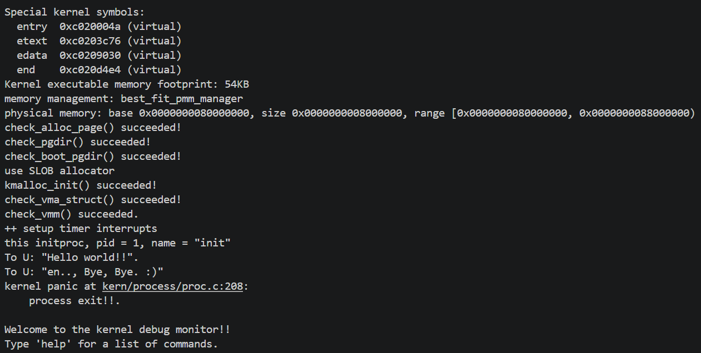
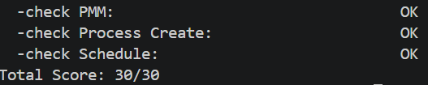

# 操作系统实验报告

## 实验基本信息

| 项目 | 内容 |
|---|---|
| **实验名称** | Lab 4：进程管理 |
| **小组成员** | 2413115-刘卓明、2411153-李江楠、2411248-沈东阳 |
| **报告整理日期** | 2026-11-20 |

### 小组分工

| 成员 | 实验任务 | 报告分工 |
|---|---|---|
| 2413115-刘卓明 | 功能模块一：虚拟内存页操作 | 功能模块一 |
| 2411153-李江楠 | 功能模块二：进程创建及初始化功能 |  功能模块二 |
| 2411248-沈东阳 | 功能模块三：进程调度；扩展练习 Challenge | 功能模块三、扩展练习 Challenge |

---

## 一、实验目的

1. 了解虚拟内存管理的基本结构，掌握虚拟内存的组织与管理方式
2. 了解内核线程创建/执行的管理过程
3. 了解内核线程的切换和基本调度过程

## 二、实验环境

| 成员 | AI 编程工具 | 底层模型 | 备注 |
|---|---|---|---|
| 2413115-刘卓明 | codex（VS Code插件） | GPT-6 | 虚拟内存页操作 |
| 2411153-李江楠 | codex CLI | GPT-6 | 进程创建及初始化功能 |
| 2411248-沈东阳 | codex（VS Code插件） | DeepSeek-v4flash | 进程调度 |

---

## 三、实验整体逻辑分析

### 3.1 本章节的逻辑主线

本实验从内核已经启动推进到调度器能让一个新建的内核线程在自己的栈上运行。启动时，内核已经在 `bootstack` 上执行。为了把 CPU 交给另一个线程，内核先要有可靠的物理页分配与虚拟映射，再为线程建立 PCB、栈和初始寄存器状态，最后由调度器选择目标并切换。三个模块对应这三个阶段。

这个过程依赖前置实验的两部分。Lab2 的物理页分配器为页表页和内核栈提供连续物理页，也是上层内核堆的基础。Lab3 的 Trap 恢复代码可以从内核栈上的一份 Trap 帧恢复寄存器和返回地址。Lab4 在创建线程时主动构造这样一份帧，让从未运行过的 init 也能沿用同一恢复路径。

### 3.2 功能的逐步实现

1. **启动与内存准备。** `kern_entry` 保存硬件线程 ID 和 DTB 地址，设置 `satp` 启用 Sv39，切到启动栈后进入 `kern_init()`。`pmm_init()` 根据设备树初始化物理页管理器，取得启动页表根的虚拟及物理地址，完成页表自检和内核堆初始化。`vmm_init()` 检查 VMA 的有序登记和查找。
2. **提供页映射操作。** 模块一复用框架的 `get_pte()` 定位页表项，通过 `page_insert()` 建立或替换映射，通过 `page_remove()` 撤销映射。修改映射后同步相关地址的 TLB，根据引用计数判断旧物理页何时可回收。这些操作在启动内存检查和评分中都会用到。
3. **建立可调度的内核线程。** 模块二的 `proc_init()` 将启动执行流登记为 idle，再创建 init。init 沿用内核页表，通过物理页分配器取得独立栈。在自己的栈上保存初始 Trap 帧，并以完备的 PCB 加入线程管理结构。此时 init 已经就绪，`current` 仍然指向 idle。
4. **选择并运行线程。** 内核初始化时钟后开启中断，进入 `cpu_idle()`。`schedule()` 从普通进程链表中选出可运行的 init，`proc_run()` 更新当前线程，`switch_to()` 切换寄存器和栈。新线程随后经 `forkret → forkrets → __trapret` 恢复初始 Trap 帧，通过 `sret` 到达 `kernel_thread_entry`，由入口汇编调用 `init_main(arg)`。

---

## 四、实验内容与实现

### 4.1 功能模块一 · 虚拟内存页操作模块

**负责人**　2413115-刘卓明

#### 模块功能描述

**需要实现/修改的函数：**

```c
int page_insert(pde_t *pgdir, struct Page *page, uintptr_t la, uint32_t perm);
void page_remove(pde_t *pgdir, uintptr_t la);
```

**功能说明：**

本模块在 实现多级页表的基本映射操作：把指定物理页映射到线性地址，或撤销已有映射。两个接口都由 `get_pte()` 定位叶页表项。插入时可按需分配中间页表，删除时只查找已有页表项。模块的关键是让页表项、物理页引用计数和 TLB 中的地址转换结果保持一致。

- **`page_insert()`**：建立新映射时，目标物理页的引用计数加一；原来就映射到同一物理页时，只更新权限，引用计数不变；替换成另一物理页时，新页的引用计数加一，原页的引用计数减一，减到零就归还给物理页分配器。写入页表项后，使对应地址的 TLB 项失效。中间页表页分配失败时返回 `-E_NO_MEM`；如果本次只建成了一层中间页表，就撤销该层的挂接并归还页表页。
- **`page_remove()`**：目标地址没有有效映射时直接返回。存在映射时，清除叶页表项并使对应地址的 TLB 项失效，再将原物理页的引用计数减一，减到零时归还该页。删除只处理目标映射，中间页表保留，因此对同一地址重复删除与删除一次的结果相同。


#### 最终提示词

以下是经过迭代优化后，最终成功实现该功能的提示词：

````markdown
[PROMPT]

**任务**：在 `kern/mm/pmm.c`的`//LAB4 function1 YOUR CODE` 标记下实现虚拟内存页操作功能，利用现有多级页表建立、更新和删除线性地址到物理页的映射。

- `page_insert`负责建立或更新映射：将指定物理页映射到目标线性地址，并设置调用者要求的权限。目标地址已有映射时，分别处理映射到同一物理页和映射到不同物理页的情况。无法分配所需的页表页时，返回 -E_NO_MEM，保持原有映射状态。
- `page_remove`负责删除映射：撤销目标线性地址已有的映射；目标地址没有有效映射时直接返回。

**操作要求**：必须在项目中修改实际文件，而不是仅展示代码。仅在 `//LAB4 function1 YOUR CODE` 标记下补全这两个函数。保留已有函数和测试代码。

**输出要求**：直接在标记位置写入完整实现，保留文件中现有代码与测试函数，使用下列 [RELY]、[GUARANTEE] 和 [SPECIFICATION] 中的信息，以工程真实代码为准。每次修改映射后，页表项、物理页引用计数和 TLB 状态应保持一致。保证通过 `check_pgdir`、`check_boot_pgdir` 和 `test_lab4_pmm_basic` 中的检查并正常编译运行。

[RELY]

**页表项类型与权限位**（`kern/mm/memlayout.h`、`kern/mm/mmu.h`）
```c
typedef uintptr_t pte_t;
typedef uintptr_t pde_t;

#define PTE_V 0x001
#define PTE_R 0x002
#define PTE_W 0x004
#define PTE_U 0x010
```

**物理页描述符与页表相关全局变量**（`kern/mm/memlayout.h`、`kern/mm/pmm.h`）
```c
struct Page {
    int ref;
    uint_t flags;
    unsigned int property;
    list_entry_t page_link;
    list_entry_t pra_page_link;
    uintptr_t pra_vaddr;
};

extern struct Page *pages;
extern pde_t *boot_pgdir_va;
```

**页表项查找与转换接口**（`kern/mm/pmm.h`、`kern/mm/pmm.c`）
```c
pte_t *get_pte(pde_t *pgdir, uintptr_t la, bool create);
static inline ppn_t page2ppn(struct Page *page);
static inline pte_t pte_create(uintptr_t ppn, int type);
static inline struct Page *pte2page(pte_t pte);
```

**物理页引用计数及分配、回收接口**（`kern/mm/pmm.h`）
```c
static inline int page_ref_inc(struct Page *page);
static inline int page_ref_dec(struct Page *page);
static inline void set_page_ref(struct Page *page, int val);
#define alloc_page() alloc_pages(1)
#define free_page(page) free_pages(page, 1)
```


**TLB 失效接口与错误码**（`kern/mm/pmm.h`、`kern/mm/pmm.c`）
```c
void tlb_invalidate(pde_t *pgdir, uintptr_t la);
static inline void flush_tlb();
#define E_NO_MEM 4
```


[GUARANTEE]

必须实现的接口（要与 `kern/mm/pmm.h` 一致）：

```c
int page_insert(pde_t *pgdir, struct Page *page, uintptr_t la, uint32_t perm);
void page_remove(pde_t *pgdir, uintptr_t la);
```

你可以根据需要添加：
本模块内部使用的 `static` 辅助函数。
模块内部使用的`static`变量

[SPECIFICATION]

## `page_insert`

**Pre-Condition**：物理内存管理已初始化，`pgdir` 指向有效的页表根，`page` 是已分配的物理页。`la` 为目标线性地址，映射以它所在的页为单位。

**Post-Condition**：成功返回 `0`。目标页表项指向指定物理页，权限位按本次传入的 `perm` 设置。

- **Case 1：目标地址没有有效映射。** 建立映射，目标物理页的引用计数加一。
- **Case 2：目标地址已映射到同一物理页。** 更新页表项中的权限，物理页的引用计数保持不变。
- **Case 3：目标地址已映射到另一物理页。** 用新映射替换原映射，新页的引用计数加一，原页的引用计数减一。原页的引用计数减到零时将其归还给分配器，有剩余引用时保留该页。
- **Case 4：所需的中间页表页分配失败。** 返回 `-E_NO_MEM`，目标地址的映射状态和数据页的引用计数保持不变。

## `page_remove`

**Pre-Condition**：`pgdir` 指向有效的页表根，`la` 为要撤销映射的线性地址，操作以它所在的页为单位。

**Post-Condition**：目标地址没有有效映射，其他地址的映射保持原样。对同一地址重复调用与删除一次的结果相同。

- **Case 1：目标地址没有有效映射。** 无论是中间页表缺失，还是目标页表项无效，均直接返回，页表和物理页引用计数保持不变。
- **Case 2：目标地址有有效映射。** 清除目标页表项，将原物理页的引用计数减一。计数减到零时归还该页，有剩余引用时保留该页。
````

##### 第一次迭代

补全两个接口，再按新建映射、同页更新权限、换页和删除映射的顺序对照实现。检查换页时，重点看原页少一个引用、新页多一个引用；检查同页更新时，则看权限改变而引用计数保持不变。分配失败路径单独对照 `get_pte()` 的两级分配过程，确认释放该页并返回 `-E_NO_MEM`。

**最终结果：**

经过 [1] 次迭代，该模块最终：
- ✅ 编译通过
- ✅ 所有相关测试通过
- ✅ 功能符合预期

**关键改进点总结：**

1. 在 `[RELY]` 中按页表查找、引用计数和 TLB 失效分组列出真实工程接口，明确复用 `get_pte()`。
2. 在 `[SPECIFICATION]` 中将同页更新权限与换页分开描述，明确每种情况下引用计数如何变化。
3. 将中间页表分配失败和删除未映射地址分别列为独立情况，明确插入失败返回 `-E_NO_MEM`，无映射时删除直接返回。

### 4.2 功能模块二：内核线程创建

**负责人：** 2411153-李江楠

#### 模块功能描述

**需要实现/修改的函数：**

```c
static struct proc_struct *alloc_proc(void);
static int copy_mm(uint32_t clone_flags, struct proc_struct *proc);
static void copy_thread(struct proc_struct *proc, uintptr_t stack, struct trapframe *tf);
int do_fork(uint32_t clone_flags, uintptr_t stack, struct trapframe *tf);
int kernel_thread(int (*fn)(void *), void *arg, uint32_t clone_flags);
void proc_init(void);
```

**功能说明：**

本模块在 `kern/process/proc.c` 的 `//LAB4 function2 2411153` 处实现内核线程创建。它先把内核启动时已经在运行的执行流登记为 idle，再为 init 分配 PCB 和独立内核栈，并准备初次运行需要的寄存器值。模块二负责把 init 准备到可运行状态，模块三负责选择并切换到它。

1. **`alloc_proc()`** 从内核堆申请一个 PCB，清零后设置 `state=PROC_UNINIT`、`pid=-1` 和默认页表地址。成功返回 PCB 指针，分配失败返回 `NULL`。
2. **`copy_mm(clone_flags, proc)`** 为新线程设置地址空间。`clone_flags` 是创建选项，`proc` 指向新 PCB。本实验的内核线程走共享启动页表的路径，父线程的 `mm` 应为 `NULL`，子线程设置 `mm=NULL` 和 `pgdir=boot_pgdir_pa`，随后返回 0。
3. **`copy_thread(proc, stack, tf)`** 把 `tf` 指向的启动帧复制到 `proc` 的内核栈高端。`stack` 指定从 Trap 返回后的栈指针，传 0 时使用子帧首地址。函数同时设置 `context.sp` 指向子帧，`context.ra` 指向 `forkret`。这让新线程在首次调度时先进入 `forkret`，随后通过 Trap 返回路径恢复帧。
4. **`do_fork(clone_flags, stack, tf)`** 负责整个创建过程。创建选项传给 `copy_mm()`，栈指针和启动帧传给 `copy_thread()`。它先申请 PCB 和两页内核栈，记录父线程为 `current`，再准备地址空间和寄存器值。准备完成后，在关本地中断的区间内分配 PID、登记链表与哈希表并标记就绪。成功返回子 PID，失败返回负错误码，并释放已经取得的资源。
5. **`kernel_thread(fn, arg, clone_flags)`** 接收新线程将来执行的函数、传给它的数据指针和创建选项。它把 `fn`、`arg` 分别写到初始帧的 `s0`、`s1`，把 `epc` 指向 `kernel_thread_entry`，并设置首次 `sret` 所需的 S 态返回状态。随后以带 `CLONE_VM` 的创建选项、默认栈参数和帧地址调用 `do_fork()`。线程真正运行时，汇编入口把 `s1` 放进 `a0`，通过 `s0` 调用线程函数。
6. **`proc_init()`** 初始化进程链表和 PID 哈希表，将复用 `bootstack` 的 idle 登记为 PID 0，并设为 `current`。随后调用 `kernel_thread(init_main, "Hello world!!", 0)` 创建 PID 1 的 init。返回时，init 拥有独立内核栈，已登记并处于就绪状态，CPU 仍在运行 idle。

**规格设计。** 在 `[RELY]` 中列出 PCB、页分配接口和 Trap 返回约定，在 `[GUARANTEE]` 中列明六个函数的签名。`[SPECIFICATION]` 先写每个函数的前置条件，再用 `proc_init()` 返回时的可观察状态检验成功结果。例如，`current == idleproc`、`initproc->parent == idleproc`，init 的 `context.ra` 和 `context.sp` 分别指向 `forkret` 和自己的启动帧。另为 `copy_thread()` 分开说明默认栈和指定栈，并为 `do_fork()` 列出各失败路径要释放的资源

#### 最终提示词

````markdown
[PROMPT]

**任务**　在 `lab4/lab4_new/kern/process/proc.c` 实现 Lab4 功能模块二「内核线程创建」。在 `//LAB4 function2 YOUR CODE` 和 `//LAB4 function3 YOUR CODE` 两个标记之间补全下列六个函数。启动时把当前执行流登记为 `idleproc`，再由它创建具有独立内核栈的 `initproc`。模块完成的时点是两个线程均已就绪，CPU 仍在执行 `idleproc`。

**操作要求**　执行此提示词时必须修改上述实际文件，复用已有辅助函数。保留模块标记，提交时仅将模块二标记中的 `YOUR CODE` 替换为本人学号。修改范围限于模块二，模块一的页表管理、模块三的调度与切换、Lab2/Lab3 的前置依赖以及评分程序均在本次范围之外。

**输出要求**　依据以下接口及行为规格完成实现，列出修改文件，简述子线程首次执行所依赖的寄存器设置，以及创建失败时如何回收资源。无需编译、运行或评分。

[RELY]

`kern/process/proc.h` 定义了 `struct proc_struct`、`struct context` 和进程状态。`context` 保存 `ra`、`sp`、`s0` 至 `s11`。`pgdir` 保存页表根的物理地址，本实验内核线程共享 `boot_pgdir_pa`，其用户地址空间描述符 `mm` 为 `NULL`。

`proc.c` 已有全局链表 `proc_list`、按 PID 索引的 `hash_list`、计数 `nr_process` 及指针 `idleproc`、`initproc`、`current`。普通子线程分别用 `list_link`、`hash_link` 接入两个索引。复用 `get_pid()`、`hash_proc()`、`find_proc()`、`set_proc_name()` 及链表操作。

PCB 由 `kmalloc` 分配，使用 `kfree` 释放。`setup_kstack(proc)` 成功时返回 0，将连续 `KSTACKPAGE` 页的内核虚拟基址写入 `proc->kstack`，失败时返回 `-E_NO_MEM`。`put_kstack(proc)` 回收已分配的栈。启动栈基址为 `bootstack`。

`kern/trap/trap.h` 的 `struct trapframe` 含 `gpr`、`status` 和 `epc` 等字段。`forkret()` 已调用 `forkrets(current->tf)`，后者通过 Trap 返回路径恢复中断帧。`kernel_thread_entry` 的汇编约定是把 `s1` 移至 `a0`，经 `s0` 调用线程函数，再将返回值交给 `do_exit`。

`kern/mm/pmm.h` 提供 `CLONE_VM`，`libs/riscv.h` 提供 `read_csr(sstatus)` 及 `SSTATUS_SPP`、`SSTATUS_SPIE`、`SSTATUS_SIE`。`local_intr_save` 与 `local_intr_restore` 成对使用，可恢复调用前的中断状态。已有 `wakeup_proc(proc)` 将尚未就绪的线程置为 `PROC_RUNNABLE`。

[GUARANTEE]

在 `proc.c` 中提供以下定义。前三个为文件内的辅助函数，后三个沿用 `proc.h` 的公开接口。

```c
static struct proc_struct *alloc_proc(void);
static int copy_mm(uint32_t clone_flags, struct proc_struct *proc);
static void copy_thread(struct proc_struct *proc, uintptr_t stack, struct trapframe *tf);
int do_fork(uint32_t clone_flags, uintptr_t stack, struct trapframe *tf);
int kernel_thread(int (*fn)(void *), void *arg, uint32_t clone_flags);
void proc_init(void);
```

[SPECIFICATION]

## alloc_proc

**Pre-Condition**　内核堆已初始化。新分配的 PCB 内存可能含有旧数据。

**Post-Condition**

- **分配成功**　返回尚未登记的 PCB。初值为 `state = PROC_UNINIT`、`pid = -1`、`pgdir = boot_pgdir_pa`。`runs`、`kstack`、`need_resched`、`flags` 均为零，`parent`、`mm`、`tf` 均为空，整个 `context` 和名称缓冲区清零。链表节点尚未挂入全局索引，进程总数保持原值。
- **分配失败**　返回 `NULL`，不产生登记记录。

## copy_mm

**Pre-Condition**　`current` 是内核线程，`proc` 指向刚分配的子 PCB。

**Post-Condition**　明确检查本实验仅支持的前提 `current->mm == NULL`。该前提成立时返回 0，子线程的 `mm` 为空，`pgdir` 指向共享的内核页表。此阶段无须分配、复制或释放用户页表。

## copy_thread

**Pre-Condition**　子线程已获得独立内核栈，`tf` 指向可读的完整模板。参数 `stack` 为零，或给出调用方指定的恢复栈指针。

**Post-Condition**　在子线程内核栈高端为一份完整中断帧预留空间，其首地址为 `proc->kstack + KSTACKSIZE - sizeof(struct trapframe)`。将模板复制到这里，令 `proc->tf` 指向副本。仅在副本中将 `gpr.a0` 设为 0，并设置 `gpr.sp`。保留模板中的线程函数、参数、入口和状态字。

**默认栈**　当 `stack == 0` 时，副本的 `gpr.sp` 指向该帧首地址，使向低地址增长的执行栈有可用空间。

**显式栈**　当 `stack != 0` 时，副本的 `gpr.sp` 取该参数值。两种情况下，首次上下文切换使用的 `context.sp` 均指向子线程自己的中断帧，`context.ra` 均指向 `forkret`。

## do_fork

**Pre-Condition**　`current` 有效，全局进程索引已初始化，`tf` 在本次调用期间有效。

**Post-Condition**

- **达到容量上限**　若 `nr_process >= MAX_PROCESS`，返回 `-E_NO_FREE_PROC`，不申请资源。
- **创建成功**　分配 PCB，记录父线程为 `current`，分配独立内核栈，再完成地址空间处理和执行现场复制。准备就绪后，分配唯一的正 PID，将子线程在 PID 哈希表和进程链表各登记一次，进程计数加一，再通过 `wakeup_proc` 使其就绪。父线程得到子 PID，此时能用 `find_proc(pid)` 找到同一 PCB，`current` 仍指向父线程。
- **创建失败**　PCB 分配失败返回 `-E_NO_MEM`。栈分配失败时只释放 PCB。地址空间处理若返回错误，则先回收已取得的栈，再释放 PCB，并传回相应负错误码。任何失败路径都应保持两个全局索引及计数与调用前一致。

**Requirements**　用保存和恢复本地中断状态的临界区保护 PID 分配、两个索引的登记和计数更新，让调度器只能选到现场完整且已登记的就绪线程。

## kernel_thread

**Pre-Condition**　`fn` 是有效的内核线程入口，`arg` 为原样传入的参数，可为空。

**Post-Condition**　从清零的局部中断帧构造启动现场。`gpr.s0` 保存 `fn`，`gpr.s1` 保存 `arg`，`epc` 指向 `kernel_thread_entry`。从当前 `sstatus` 派生帧中的 `status`，设置 `SPP` 和 `SPIE`，清除 `SIE`，保留其余位，使首次 `sret` 返回监管态并启用中断。用 `clone_flags | CLONE_VM`、零栈参数和该帧调用 `do_fork`，原样返回 PID 或负错误码。创建者返回后，子线程的现场仍然有效。

## proc_init

**Pre-Condition**　`kern_init()` 已完成内存管理初始化，当前正在启动栈上执行，进程子系统首次初始化。

**Post-Condition**

**建立 idle**　初始化进程链表表头及所有哈希桶。用 `alloc_proc()` 分配 `idleproc`，赋 PID 0，命名为 `idle`，复用 `bootstack`，状态设为 `PROC_RUNNABLE`，`need_resched` 置位。使 `current == idleproc` 并把 idle 计入进程总数。idle 单独由 `idleproc` 持有，供调度器兜底。其 `parent`、`mm`、`tf` 为空，`runs`、`flags` 和初始上下文为零。

**建立 init**　以 idle 为父线程，通过 `kernel_thread(init_main, "Hello world!!", 0)` 创建第一个普通内核线程。用返回的 PID 查得 PCB 后赋给 `initproc`，命名为 `init`。此时 `initproc->pid == 1`、`initproc->parent == idleproc`，其独立内核栈及首次运行现场已就绪。系统共计两个线程，普通进程链表中只有 init。返回调用者，实际切换由后续调度路径负责。

**启动失败**　idle PCB 分配失败、init 创建失败或按成功 PID 找不到 init 时，使用框架的致命错误处理终止初始化，并指出失败阶段。
````

##### 第一次迭代

根据四段式提示词实现六个函数，再对照最终版源码检查 idle 的初始值、init 的栈和启动帧，以及 `do_fork()` 的资源申请、失败清理和登记顺序

**最终结果：**

- 编译和链接通过，QEMU 成功启动内核
- 模块二对应的 `Process Create` 检查通过，综合评分为 `30/30`

**关键改进点总结：**

1. 在 `[SPECIFICATION]` 中分别描述 idle 复用启动栈、init 申请独立栈的条件与结果
2. 明确 `context.sp` 用于调度切换，子帧内的 `gpr.sp` 由默认栈或显式栈参数决定
3. 按资源申请顺序列出失败时的释放步骤，并要求在准备完成后再分配 PID、登记和唤醒

---

### 4.3 功能模块三 · 线程调度与上下文切换

**负责人**　2411248-沈东阳

#### 模块功能描述

**需要实现/修改的函数：**

```c
void schedule(void);
void proc_run(struct proc_struct *proc);
void switch_to(struct context *from, struct context *to);
void cpu_idle(void);
```

**功能说明：**

本模块在 `kern/schedule/sched.c`、`kern/process/proc.c` 和 `kern/process/switch.S` 的 `//LAB4 function3 2411248` 处实现调度与上下文切换。模块二把 init 准备到 `PROC_RUNNABLE` 并挂入 `proc_list`，模块三负责从链表中选出下一个可运行线程，并在需要时保存当前线程的 `context`、恢复目标线程的 `context`。四个函数形成一条链：`schedule()` 选人，`proc_run()` 换人，`switch_to()` 换现场，`cpu_idle()` 在没有可运行线程时兜底。

1. **`schedule()`** 在关中断的临界区内清除 `current->need_resched`，从当前线程之后环形扫描 `proc_list`。`idleproc` 不在链表中，因此当前线程为 idle 时从链表头开始；否则从 `current->list_link` 的后继开始，跳过哨兵头和 `current`，选第一个 `PROC_RUNNABLE`。若没有其他可运行线程，则选择仍可运行的 `current`，否则选择 `idleproc`。选中后增加 `runs`，只有目标不是当前线程时才调用 `proc_run()`。
2. **`proc_run(proc)`** 负责真正切换。若目标就是 `current` 则直接返回；否则先保存 `prev = current`，在关中断区间内把 `current` 改为目标，把目标内核栈顶 `proc->kstack + KSTACKSIZE` 写入 `sscratch`，再调用 `switch_to(&prev->context, &proc->context)`。`switch_to` 返回时，本线程已经被重新调度回来，此时恢复中断状态。
3. **`switch_to(from, to)`** 是汇编层的上下文搬运：把当前线程的 `ra`、`sp`、`s0` 至 `s11` 保存到 `from->context`，从 `to->context` 恢复同样的 14 个寄存器，最后用 `ret` 跳到 `to->context.ra`。已运行线程的 `ra` 是它上次调用 `switch_to` 的返回地址；新线程的 `ra` 是 `forkret`，因此会走 `forkret → forkrets → __trapret → kernel_thread_entry` 的首次执行路径。
4. **`cpu_idle()`** 是 idleproc 的主循环。每轮把 `current->need_resched` 置 1 并调用 `schedule()`；没有可运行线程时，`schedule()` 选回 idle，`proc_run()` 发现目标就是当前线程而直接返回，循环继续。

**模块交互。** 模块二通过 `do_fork()` 把新线程插入 `proc_list`，通过 `wakeup_proc()` 把它置为 `PROC_RUNNABLE`；模块三只读取 `state`、`list_link`、`context` 和 `kstack`，不修改模块二的创建逻辑。`switch_to` 的上下文布局由 `kern/process/proc.h` 的 `struct context` 决定，`proc_run` 与 `schedule` 都使用同一份布局。测试由 `tools/inject.py` 在 `init_main()` 开头注入 `test_lab4_schedule()`，创建两个测试线程并由主线程主动调用 `schedule()`。

#### 最终提示词

以下是经过迭代优化后，最终成功实现该功能的提示词：

````markdown
[PROMPT]

**任务**：在 `kern/schedule/sched.c` 的 `//LAB4 function3 2411248` 处实现 `schedule()`；在 `kern/process/proc.c` 末尾的同一标记处实现 `proc_run()` 与 `cpu_idle()`；在 `kern/process/switch.S` 中实现 `switch_to()`。三者共同完成“选择下一个可运行进程 → 更新 `current` 与内核栈 → 保存当前上下文、恢复目标上下文 → 新进程从自己的返回地址继续执行”的调度闭环。

**操作要求**：必须修改项目中的实际文件，而不是只展示代码。只允许在上述三个文件的指定标记或现有空文件内补全实现；保留 `wakeup_proc()`、`alloc_proc()`、`do_fork()`、`proc_init()`、`kernel_thread()`、`copy_thread()` 等已有函数及注释，不要删除或改写既有逻辑。不得修改 `proc.h`、`sched.h`、`tools/test_lab4.c`、`tools/inject.py`、`tools/grade.sh`、`Makefile`、`CMakeLists.txt`；不得改动 `trap.c`、`trapentry.S` 等 lab3 代码；不得实现 lab5 的 `do_exit()` 或用户进程功能。保留 `LAB4 function3` 标记，并将 `YOUR CODE` 替换为学号 `2411248`。

**输出要求**：直接在文件中写入完整实现，保证 `make` 能编译、`make grade` 能运行；调度测试应输出 `[Test Schedule] PASS`，并保留 `this initproc, pid = 1, name = "init"` 等既有输出。使用下面 `[RELY]`、`[GUARANTEE]`、`[SPECIFICATION]` 中的信息，以工程真实代码为准；模块完成后不得破坏 `[Test PMM] PASS` 与 `[Test Process Create] PASS`。

[RELY]

**进程控制块与上下文布局**（`kern/process/proc.h`）

```c
struct context {
    uintptr_t ra;      // 偏移 0
    uintptr_t sp;      // 偏移 1
    uintptr_t s0;      // 偏移 2
    uintptr_t s1;      // 偏移 3
    uintptr_t s2;      // 偏移 4
    uintptr_t s3;      // 偏移 5
    uintptr_t s4;      // 偏移 6
    uintptr_t s5;      // 偏移 7
    uintptr_t s6;      // 偏移 8
    uintptr_t s7;      // 偏移 9
    uintptr_t s8;      // 偏移 10
    uintptr_t s9;      // 偏移 11
    uintptr_t s10;     // 偏移 12
    uintptr_t s11;     // 偏移 13
};

struct proc_struct {
    enum proc_state state;
    int pid;
    int runs;
    uintptr_t kstack;
    volatile bool need_resched;
    struct proc_struct *parent;
    struct mm_struct *mm;
    struct context context;
    struct trapframe *tf;
    uintptr_t pgdir;
    uint32_t flags;
    char name[PROC_NAME_LEN + 1];
    list_entry_t list_link;
    list_entry_t hash_link;
};

extern list_entry_t proc_list;
extern struct proc_struct *idleproc, *initproc, *current;
```

**进程队列与链表接口**（`libs/list.h`）

`proc_list` 是带哨兵头的双向循环链表；`list_next(&proc_list)` 取首元素；`le2proc(le, list_link)` 由链表节点取回 PCB。`idleproc` 由 `proc_init()` 单独创建，不会插入 `proc_list`；`initproc` 和 `kernel_thread()` 创建的线程由 `do_fork()` 通过 `list_add(&proc_list, &proc->list_link)` 插入。因此扫描时不能假设 `idleproc` 在队列中，也不能对哨兵头 `&proc_list` 调用 `le2proc`。

**已有函数与初始状态**

- `wakeup_proc(proc)` 已实现，只把 `proc->state` 置为 `PROC_RUNNABLE`；
- `proc_init()` 已设置 `idleproc->state = PROC_RUNNABLE`、`idleproc->need_resched = 1`、`idleproc->kstack = (uintptr_t)bootstack`、`current = idleproc`；
- `kernel_thread()` → `do_fork()` → `copy_thread()` 已为新线程建立 `tf`、`context.ra = forkret`、`context.sp = tf`；`forkret()` 会调用 `forkrets(current->tf)` 进入 `__trapret`；
- `switch_to()` 在 `proc.c` 中已有声明：`void switch_to(struct context *from, struct context *to);`
- `proc_run()`、`cpu_idle()` 在 `proc.h` 中已有声明，`schedule()` 在 `sched.h` 中已有声明。

**中断、内核栈与 CSR**

- `sync.h` 提供 `local_intr_save(intr_flag)` / `local_intr_restore(intr_flag)`；
- `memlayout.h`：`KSTACKPAGE = 2`，`KSTACKSIZE = KSTACKPAGE * PGSIZE`；`proc->kstack` 是内核栈低地址，栈顶为 `proc->kstack + KSTACKSIZE`；
- `idleproc` 的栈是 `kern/init/entry.S` 中的 `bootstack`，栈顶为 `bootstacktop`；
- `riscv.h` 提供 `write_csr(sscratch, val)`、`STORE`、`LOAD`、`REGBYTES`；`switch.S` 需要包含 `<riscv.h>`。

**地址空间**

`copy_mm()` 把 `proc->pgdir` 统一设为 `boot_pgdir_pa`，本实验所有内核线程共享内核页表；模块三不需要切换 `satp`，也不要调用 32 位专用的 `lsatp()`。

**测试行为**（`tools/test_lab4.c`，评分时由 `tools/inject.py` 注入到 `init_main()` 开头）

- `test_lab4_schedule()` 先通过 `kernel_thread()` 创建两个 `test_lab4_thread` 线程；
- 两个线程各自循环 3 次，每次置 `current->need_resched = 1` 后调用 `schedule()`，之后进入无限让出循环；
- 测试主体（`initproc`）也循环 8 次，置 `need_resched = 1` 并调用 `schedule()`；
- 最后断言两个线程都运行过，打印 `[Test Schedule] PASS`；
- `tools/grade.sh` 还要求输出 `this initproc, pid = 1, name = "init"`、`To U: "Hello world!!".`、`To U: "en.., Bye, Bye. :)"`。

**构建**：`Makefile` 的 `CTYPE := c S`，`KSRCDIR` 包含 `kern/process`，`kern/process/switch.S` 会被自动编译；不需要修改 `Makefile` 或 `CMakeLists.txt`。

[GUARANTEE]

必须实现以下四个函数/符号，签名不可改：

```c
/* kern/schedule/sched.c */
void schedule(void);

/* kern/process/proc.c */
void proc_run(struct proc_struct *proc);
void cpu_idle(void);

/* kern/process/switch.S */
void switch_to(struct context *from, struct context *to);
```

- `schedule()` 写在 `sched.c` 的 `//LAB4 function3 2411248` 处，保留 `wakeup_proc()` 原样；
- `proc_run()`、`cpu_idle()` 写在 `proc.c` 末尾的同一标记处，保留 `alloc_proc()`、`do_fork()`、`proc_init()` 等已有实现；
- `switch_to()` 写在 `switch.S`，必须有 `.text` 与 `.globl switch_to`；当前文件只有一行标记，可直接替换为完整汇编；
- `switch_to` 的偏移必须与 `struct context` 一致：`ra=0`、`sp=1`、`s0=2`、…、`s11=13`，单位 `REGBYTES`；
- 可以增加模块内部 `static` 辅助函数/变量，但不得新增跨文件接口，不得改动 `proc.h`、`sched.h` 的已有声明；
- 不得修改 `tools/test_lab4.c`、`tools/inject.py`、`tools/grade.sh`、`Makefile`、`CMakeLists.txt`；
- 不得修改 `kern/trap/trap.c`、`kern/trap/trapentry.S` 等 lab3 代码，也不得实现 lab5 的 `do_exit()`/用户进程功能；
- 完成后必须同时保持 `[Test PMM] PASS`、`[Test Process Create] PASS`、`[Test Schedule] PASS`。

[SPECIFICATION]

## switch_to

**Pre-Condition**：`from`、`to` 均指向有效的 `struct context`；调用发生在内核态，`sp` 指向当前内核栈；调用者已关闭中断。

**Post-Condition**：`from` 中依次保存调用点的 `ra`、`sp`、`s0`–`s11`；从 `to` 中恢复同样 14 个值；执行 `ret` 后，控制流跳到 `to->ra`，栈指针为 `to->sp`，`s0`–`s11` 为 `to` 中的值。

**Requirements**：
- 必须使用 `<riscv.h>` 提供的 `STORE`、`LOAD`、`REGBYTES`，不能硬编码 8 字节偏移；
- 保存/恢复顺序必须与 `struct context` 完全一致：`ra` 0、`sp` 1、`s0` 2、`s1` 3、…、`s11` 13；
- 只能把 `a0`、`a1` 作为 `from`/`to` 指针；不要用 `s0`–`s11` 做临时寄存器；
- 不需要保存/恢复 `a0`、`a1`、`t0`–`t6`；不要写 C 函数序言/尾声，也不要在 `switch_to` 内调用其它函数；
- 最后一条指令必须是 `ret`，由恢复出的 `to->ra` 决定返回位置。

**Case 1（切换到已运行过的线程）**：`to->ra` 是 `to` 上次调用 `switch_to` 时的返回地址；`ret` 后它从该点继续，`proc_run()` 随后恢复中断并返回。

**Case 2（首次切换到新线程）**：`to->ra = forkret`、`to->sp = tf`；`ret` 后执行 `forkret()`，它用 `current->tf` 调用 `forkrets()`，再进入 `__trapret` 恢复新线程的 Trap frame。

## proc_run

**Pre-Condition**：`proc != NULL`，`proc->state == PROC_RUNNABLE`；`current` 指向当前进程；中断可以已开启或已关闭。

**Post-Condition**：若 `proc == current`，立即返回，不切换；否则在关中断临界区内把 `current` 改为 `proc`，把 `sscratch` 设为 `proc->kstack + KSTACKSIZE`，调用 `switch_to(&prev->context, &proc->context)`；当本进程以后再次被调度时，`switch_to` 返回到此处，恢复调用前的中断状态。

**Requirements**：
- 必须在修改 `current` 前保存 `prev = current`，并把目标保存在局部变量 `next` 中；
- `write_csr(sscratch, ...)` 必须在 `switch_to` 之前执行；
- 使用 `local_intr_save(intr_flag)` / `local_intr_restore(intr_flag)` 包住 `current` 更新与 `switch_to`；
- `switch_to` 返回后不要再写 `current = proc`：返回发生在该进程被重新调度时，参数 `proc` 可能已不是当前进程；
- 不切换页表，不清 `need_resched`，不操作 `proc_list`；
- 不要在 `proc_run` 内调用 `schedule()`。

**Case 1（`proc == current`）**：直接返回。
**Case 2（`proc != current`）**：关中断，更新 `current` 和 `sscratch`，调用 `switch_to`；本进程恢复后开中断并返回。

## schedule

**Pre-Condition**：`current` 有效；`proc_list` 已由 `proc_init()` 初始化；调用者可以是 `idleproc`、`initproc` 或任一内核线程；中断可以已开启。

**Post-Condition**：`current->need_resched` 被清零；从 `proc_list` 中按环形顺序选出下一个 `PROC_RUNNABLE` 进程 `next`；`next->runs` 加一；若 `next != current`，调用 `proc_run(next)` 完成切换；函数返回时，`current` 指向本进程，中断状态恢复。

**Requirements**：
- 必须在关中断临界区内完成“扫描 + 选择 + `proc_run` 调用”，返回前恢复中断；
- 扫描起点：`current == idleproc` 时从 `&proc_list` 开始，否则从 `&current->list_link` 开始；
- 用 `list_next()` 环形前进，遇到哨兵头 `&proc_list` 跳过，不能对头节点调用 `le2proc`；
- 只选择 `state == PROC_RUNNABLE` 的进程；`PROC_UNINIT`、`PROC_SLEEPING`、`PROC_ZOMBIE` 一律跳过；
- 第一轮扫描跳过 `current` 自身；若没有其它可运行进程，再检查 `current` 是否仍为 `PROC_RUNNABLE`，是则选 `current`；否则选 `idleproc`；
- `idleproc` 不在 `proc_list` 中，必须作为兜底单独处理；`proc_list` 为空时直接选 `idleproc`；
- 不得在扫描中修改任何进程的 `state`，不得调用 `wakeup_proc()`、`do_exit()` 或睡眠；
- 选中后执行 `next->runs++`；若 `next == current`，不调用 `proc_run`，直接恢复中断并返回；
- 不要递归调用 `schedule()`。

**Case 1（存在其它 RUNNABLE）**：选扫描到的第一个，切换。
**Case 2（只有 current 为 RUNNABLE）**：选 current，`runs++`，不切换。
**Case 3（没有 RUNNABLE）**：选 `idleproc`；若 `current == idleproc`，不切换。
**Case 4（`proc_list` 为空）**：选 `idleproc`。

## cpu_idle

**Pre-Condition**：`current == idleproc`，在 `kern_init()` 末尾被调用。

**Post-Condition**：永不返回；循环把 `current->need_resched` 置 1 并调用 `schedule()`；没有可运行进程时，`schedule()` 选回 `idleproc`，循环继续。

**Requirements**：
- 必须是无限循环，不能返回；
- 每轮必须调用 `schedule()`，不能只忙等；
- 不调用 `panic()`，不修改 `idleproc` 之外的状态。
````

##### 第一次迭代

按照四段式提示词先实现 `switch_to()` 的 14 个偏移，再实现 `proc_run()` 的 `current`/`sscratch`/`switch_to` 顺序，最后补全 `schedule()` 的扫描与兜底，并把 `cpu_idle()` 接到 `kern_init()` 末尾。第一次编译后重点检查三处：

1. `schedule()` 的扫描起点是否区分 idle 和普通线程。idle 不在 `proc_list` 中，若统一从 `current->list_link` 开始会取到非法节点；改为 `current == idleproc ? &proc_list : &current->list_link`。
2. `proc_run()` 是否在 `switch_to()` 之前更新 `current` 和 `sscratch`。`forkret()` 通过 `current->tf` 找新线程的启动帧，顺序反了会取到旧线程的 Trap frame；同时 `switch_to()` 返回后不能再写 `current = proc`，否则恢复时会把当前线程改回旧目标。
3. `switch_to()` 的偏移是否与 `struct context` 一致。按 `ra=0`、`sp=1`、`s0=2` 至 `s11=13` 建表逐项核对，并确认没有用 `s0` 至 `s11` 做临时寄存器、没有在函数内调用其它函数破坏 `ra`。

**最终结果：**

经过 1 次迭代，该模块最终：

- ✅ 编译通过
- ✅ `[Test Schedule] PASS`
- ✅ `make grade` 三项全部通过，总分 `30/30`
- ✅ `make qemu` 保留 init 的预期输出

**关键改进点总结：**

1. 在 `[RELY]` 中明确 `idleproc` 不在 `proc_list`、`proc_list` 是带哨兵头的循环链表，避免扫描到哨兵头。
2. 在 `[SPECIFICATION]` 中把“扫描起点”“跳过 current”“兜底 current/idle”分开描述，覆盖只有当前线程、全部睡眠、链表为空等边界。
3. 在 `[SPECIFICATION]` 中明确 `proc_run()` 的更新顺序和 `switch_to()` 返回语义，避免在切换后错误重写 `current`。
4. 在 `[GUARANTEE]` 中固定 `switch_to` 的 14 个偏移和 `.globl` 符号，保证汇编与 C 结构体布局一致。

### 4.4 Challenge · 中断开关与分页模式

**负责人**　2411248-沈东阳

#### Challenge 1：`local_intr_save/restore` 如何开关中断

`local_intr_save` 和 `local_intr_restore` 不是简单地“关中断/开中断”，而是“保存进入前的状态 → 关中断 → 恢复原状态”。

`kern/driver/intr.c`：

```c
void intr_enable(void)  { set_csr(sstatus, SSTATUS_SIE); }
void intr_disable(void) { clear_csr(sstatus, SSTATUS_SIE); }
```

`SSTATUS_SIE` 是 `sstatus` 的 bit 1（值为 `0x2`），是 S 态的全局中断使能位：

- `intr_enable()` 用 `csrrs` 把 `SIE` 置 1；
- `intr_disable()` 用 `csrrc` 把 `SIE` 清 0；
- 它们只改总开关，不修改 `sie` 中各个中断源的使能位。

`kern/sync/sync.h`：

```c
static inline bool __intr_save(void) {
    if (read_csr(sstatus) & SSTATUS_SIE) {
        intr_disable();
        return 1;
    }
    return 0;
}

static inline void __intr_restore(bool flag) {
    if (flag) {
        intr_enable();
    }
}
```

`local_intr_save(intr_flag)` 展开为 `intr_flag = __intr_save()`：

1. 读 `sstatus`；
2. 检查 `SIE` 是否为 1；
3. 如果原来为 1：用 `csrrc` 清 `SIE`，返回 1；
4. 如果原来为 0：保持关中断，返回 0。

`local_intr_restore(intr_flag)` 展开为 `__intr_restore(intr_flag)`：

- `intr_flag == 1`：原来开中断，调用 `intr_enable()` 重新置 `SIE`；
- `intr_flag == 0`：原来就是关中断，不做任何操作。

| 进入前 `SIE` | `intr_flag` | 临界区内 `SIE` | 离开后 `SIE` |
|---|---|---|---|
| 1（开） | 1 | 0（关） | 1（开） |
| 0（关） | 0 | 0（关） | 0（关） |

这样做的原因是支持嵌套：外层 `intr_flag=1`，内层 `intr_flag=0`；内层恢复时不会提前开中断，外层结束时才恢复。`schedule` 和 `proc_run` 都使用这一对宏保护 `proc_list`、`current`、`sscratch` 和上下文切换。

补充：Trap 进入时硬件会把 `sstatus.SIE` 保存到 `sstatus.SPIE` 并清 `SIE`，`sret` 再把 `SPIE` 恢复到 `SIE`。因此 Trap 处理程序默认在关中断状态下运行。

#### Challenge 2：不同分页模式与 `get_pte()` 的设计

`get_pte(pgdir, la, create)` 的作用是：给定页目录 `pgdir` 和线性地址 `la`，返回 `la` 对应的最后一级 PTE 指针；如果中间页表不存在，根据 `create` 决定是否分配。

```c
pte_t *get_pte(pde_t *pgdir, uintptr_t la, bool create);
```

`create = 1` 时，缺失的中间页表会分配一页、清零、设置引用计数并写入上一级 PTE；`create = 0` 时只查询，不再分配，缺失就返回 `NULL`。`page_insert()` 用 `create=1` 建立映射，`get_page()`/`page_remove()` 用 `create=0` 只查询。

##### 两段代码为什么相似

`get_pte()` 中有两段几乎相同的代码：

```c
pde_t *pdep1 = &pgdir[PDX1(la)];
if (!(*pdep1 & PTE_V)) {
    // 分配页表页、清零、设置引用计数
    *pdep1 = pte_create(page2ppn(page), PTE_U | PTE_V);
}

pde_t *pdep0 = &((pte_t *)KADDR(PDE_ADDR(*pdep1)))[PDX0(la)];
if (!(*pdep0 & PTE_V)) {
    // 同样的分配逻辑
    *pdep0 = pte_create(page2ppn(page), PTE_U | PTE_V);
}

return &((pte_t *)KADDR(PDE_ADDR(*pdep0)))[PTX(la)];
```

这两段分别处理 Sv39 的两个非叶子层：

- 第一段：用 `PDX1(la)` 索引第一级页目录；
- 第二段：用 `PDX0(la)` 索引第二级页目录；
- 最后用 `PTX(la)` 返回叶子 PTE。

每一级页表的 walk 逻辑完全相同：

1. 用当前级的 VPN 索引取出 PTE；
2. 检查 `PTE_V`；
3. 无效且 `create` 时，分配 4KB 页、清零、设置引用计数；
4. 把下一级页表的物理页号和标志写进当前 PTE；
5. 继续下一级。

只是索引的位段和当前页表指针不同，所以代码看起来像复制粘贴。

##### Sv32、Sv39、Sv48 的异同

| 规格 | 虚拟地址位宽 | 页表级数 | PTE 大小 | 每级 VPN 位数 | 大页 |
|---|---|---|---|---|---|
| Sv32 | 32 | 2 | 4B | 10 | 4MiB |
| Sv39 | 39 | 3 | 8B | 9 | 2MiB / 1GiB |
| Sv48 | 48 | 4 | 8B | 9 | 2MiB / 1GiB / 512GiB |

- **Sv32**：两级页表，4KB 页，32 位 PTE，每级 10 位 VPN，1024 个页表项；
- **Sv39**：三级页表，4KB 页，64 位 PTE，每级 9 位 VPN，512 个页表项；
- **Sv48**：四级页表，4KB 页，64 位 PTE，每级 9 位 VPN，512 个页表项。

本实验的 `mmu.h`：

```c
#define PDX1(la) ((((uintptr_t)(la)) >> 30) & 0x1FF)
#define PDX0(la) ((((uintptr_t)(la)) >> 21) & 0x1FF)
#define PTX(la)  ((((uintptr_t)(la)) >> 12) & 0x1FF)
```

`0x1FF` 是 9 位，PTE 是 8 字节，所以这是 **Sv39 风格**。Sv39 有两个非叶子层，因此写成两段相似代码；如果换成 Sv48，需要再增加一层；如果换成 Sv32，每级索引变成 10 位、PTE 变成 4 字节，移位和掩码都要改。

因此，两段代码相似的根本原因是：**分页 walk 在每一级是同一个算法，只是级数、索引位段和 PTE 宽度不同。** 也可以写成循环：

```c
for (level = levels - 1; level > 0; level--) {
    pte_t *pte = &table[vpn[level]];
    if (!(*pte & PTE_V)) {
        if (!create) return NULL;
        page = alloc_page();
        ...
        *pte = pte_create(page2ppn(page), PTE_V | PTE_U);
    }
    table = (pte_t *)KADDR(PDE_ADDR(*pte));
}
return &table[vpn[0]];
```

这样 Sv32/39/48 只是 `levels`、`vpn` 位宽和 PTE 大小不同，代码可以统一。

##### 把“查找”和“分配”合在一个函数里好不好？

当前 `get_pte()` 用 `create` 参数把两件事合在一起：

- 查找页表项；
- 按需分配中间页表页。

**优点：**

1. 调用者只需要一个接口，不需要知道页表有几级；
2. `page_insert()`、`get_page()`、`page_remove()` 可以复用同一条遍历路径；
3. `create` 标志明确区分“查询”和“建立”，教学实现简单；
4. 避免在调用者里重复写页表遍历和分配代码。

**缺点：**

1. **职责不单一**：函数名是 `get_pte`，但 `create=1` 时有分配副作用，读代码时容易忽略“这个 get 可能会分配内存”。
2. **错误处理复杂**：`get_pte()` 可能在分配了第一级页表后，第二级分配失败；`page_insert()` 必须回滚已经建立的中间页表，否则泄漏。当前 `page_insert()` 的失败清理逻辑就是这种复杂性的体现。
3. **分配策略被写死**：清零、设置引用计数、`PTE_U|PTE_V` 等策略都嵌在 `get_pte()` 里，不利于替换分配器、支持大页或做影子页表。
4. **调用者容易误用**：如果只想查询却传了 `create=1`，会在读路径上意外分配内存；在关中断/持锁/缺页处理等上下文中，这种隐藏分配可能带来问题。
5. **不利于测试和扩展**：查找逻辑和分配逻辑不能分别测试；增加 Sv48 或大页支持时，函数会越来越复杂。

**我的看法：**

- 对教学实验，这种写法可以接受：接口少、代码短，`create` 的语义也写在了注释和规格里；
- 对真实内核或可扩展实现，更推荐拆开，至少拆成“只查找”和“查找并分配”两个入口：
  - `walk_pte(pgdir, la)`：只查找，缺失返回 `NULL`，绝不分配；
  - `get_pte_alloc(pgdir, la)`：查找并在需要时分配，返回可用 PTE；
  - 两者共用一个内部 `walk(pgdir, la, alloc)` 辅助函数，避免重复遍历。
- 这样 `page_insert()` 明确调用分配版，`get_page()/page_remove()` 明确调用查找版；分配失败和回滚逻辑更清晰，读路径也不会意外分配。
- 如果不想增加接口，也可以保留 `get_pte(pgdir, la, create)`，但应把“分配”抽成独立的 `alloc_pte_table()`，并让调用者能知道是否发生了部分分配，以便回滚。

结论：**当前合并写法在实验规模下简单有效；从工程角度看，拆分查找与分配职责更清晰、更安全，尤其有利于错误处理、扩展分页模式和避免隐藏副作用。**

---

## 五、测试与验证

### 5.1 普通启动与线程执行

在实验代码目录运行 `make qemu`。镜像成功链接并由 QEMU 启动，主要输出如下。

```text
check_alloc_page() succeeded!
check_pgdir() succeeded!
check_boot_pgdir() succeeded!
use SLOB allocator
kmalloc_init() succeeded!
check_vma_struct() succeeded!
check_vmm() succeeded.
++ setup timer interrupts
this initproc, pid = 1, name = "init"
To U: "Hello world!!".
To U: "en.., Bye, Bye. :)"
kernel panic at kern/process/proc.c:208:
    process exit!!.
```



输出中的 PID、线程名和字符串分别验证了当前 PCB 的身份及实参传递。最后的 `process exit!!.` 来自本版已知的退出路径。`init_main()` 完成输出后返回 0，`kernel_thread_entry` 随即调用 `do_exit()`，其函数体直接触发 panic，系统随后进入调试监视器

### 5.2 综合评分

`make grade` 在临时副本中注入测试。提供的运行记录显示三项各得 10 分。

```text
  -check PMM:                                OK
  -check Process Create:                     OK
  -check Schedule:                           OK
Total Score: 30/30
```

| 检查项 | 注入位置 | 覆盖内容 |
|---|---|---|
| PMM | `pmm_init()` 末尾 | 建立、替换、同页更新权限及删除映射，核对引用计数和重复删除行为 |
| Process Create | `proc_init()` 末尾 | 检查 `current == idleproc`、idle 的 PID 和启动栈，以及 init 的 PID、父线程、就绪状态和非零的初始 `context.ra`、`context.sp` |
| Schedule | `init_main()` 开头 | 创建两个测试线程，主动调用调度，检查两个线程都曾运行，同时评分脚本检查 init 的预期输出 |



### 5.3 编译警告与链接信息

- **`-Wint-conversion`。** `kmalloc.c:92` 将类型为 `unsigned long` 的内核虚拟地址传入要求 `void *` 的 `kva2page()`。该值来自指针地址。在日志中的 RV64 运行环境，转换未造成观察到的地址截断或评分失败。若统一接口类型，可以让 `__slob_free_pages()` 直接接收指针，减少整数与指针之间的转换。
- **`-Wincompatible-pointer-types`。** 注入的测试在两次调用 `kernel_thread()` 时传入返回 `void` 的 `test_lab4_thread`，而公开接口要求 `int (*)(void *)`。测试线程在循环中主动调度且没有返回，日志显示两个都运行到了。将测试回调声明与公开接口统一可消除这条警告。
- **`removing unused section`。** 链接选项 `--gc-sections --print-gc-sections` 会剔除并列出未被保留的节。日志随后生成 `bin/ucore.img` 并启动内核

---

## 六、实验总结与收获

### 6.1 实验知识点与操作系统原理的联系

| 实验知识点 | 对应的 OS 原理 | 联系与差异 |
|---|---|---|
| Sv39 页表、VMA 和 TLB | 分页、地址翻译与内存保护 | 页表给出当前的物理映射和硬件权限，VMA 描述软件管理的地址范围，更新映射后需要同步缓存的翻译 |
| 同一物理页的多个映射 | 物理页共享与引用计数 | 两个虚拟页可以引用同一物理页。撤销一个映射后，应保持另一条映射有效，直到最后一个受管理的引用撤销才释放物理页 |
| `proc_struct`、进程链表和 PID 哈希表 | 进程控制块与进程管理 | PCB 集中记录线程状态与资源，链表供调度遍历，哈希表供按号查询。实验中的 idle 另由全局指针持有 |
| 共享页表与独立内核栈 | 地址空间与线程执行状态 | 内核线程使用同一地址空间，栈与寄存器状态各自独立，能够在切换后从本线程的调用现场继续 |
| `context` 和 `trapframe` | 调度上下文与 Trap 返回现场 | `context` 对应普通函数调用边界，`trapframe` 对应需要由 `sret` 恢复的指令地址与特权状态。新线程按顺序用到这两份信息 |
| 本地中断保护和链表轮转 | 临界区、协作调度与抢占调度 | 关本地中断保护本 hart 上的状态更新。最终版由 idle 和测试线程主动进入调度路径，时钟分支负责设置下一次事件和统计 |

### 6.2 OS 原理中重要但本实验主体未完整覆盖的知识点

1. 用户进程的独立地址空间、用户态程序装载及系统调用接口。本实验主体中的 `copy_mm()` 复用启动页表。
2. 写时复制、缺页时按需分配、换入换出和页置换策略。本版 VMM 启动检查验证 VMA 管理，完整缺页检查调用仍在注释中。
3. 基于时间片的抢占、优先级调度及多核上的调度同步。本版线程切换由显式调度调用触发。
4. 从线程退出到父进程等待和资源回收的完整生命周期。`do_exit()` 当前通过 panic 结束演示。

### 6.3 AI 协作开发的经验

1. 先把可观察的结果写进规格。比如 `proc_init()` 返回时的 `current`、idle 的栈和 init 的父指针，都能直接对照断言。
2. 明确容易混淆的参数与字段。创建选项的 `0`、默认栈参数的 `0`、`context.sp` 和帧里的 `gpr.sp` 各有用途，应结合 C 和汇编的消费位置核对。
3. 将失败清理写成资源获取的逆序。创建者先拿到 PCB，再取得栈，接着准备地址空间和执行现场。只有全部准备完成，才向进程索引公开该对象。
4. 结合日志和源码判断问题。编译器警告要追到实际参数类型和调用方，运行时的退出信息则要根据 `init_main → do_exit` 的路径解释。评分通过后仍要说明测试覆盖到了哪些状态。
